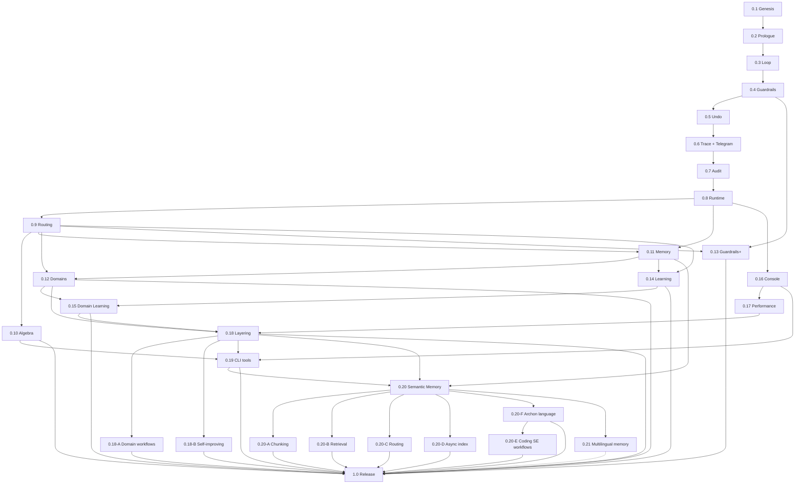

# Trek Agent — Implementation Roadmap

**Status:** **0.20.4 current** (`v0.20.4`). Semantic memory + coding SE workflows shipped. **Next:** 0.21.0 Multilingual memory, then **1.0.0** Release (first RC: `v1.0.0-rc.1`).  
**Baseline:** `pi-original/` (Pi Coding Agent monorepo) → hard fork into `trek/` (independent repo)  
**Versioning:** Stages through 0.20 are **minor** releases (`0.1.0` … `0.20.x`). **1.0.0** is the first **major** ship gate. Patch releases remain hotfixes within a stage. Pre-1.0 RCs use `1.0.0-rc.N` (GitHub release only; **no npm** until an explicit later decision).  
**Sources:** `PROMPT.md`, `SPECS_SAFETY_HARNESS.md` (safety harness), `SPECS_REFLECTIVE_AGENT.md` (reflective loop). **Canonical agent cycle:** `Observe → Intend → Act → Reflect` (O→I→A→R). The safety spec’s Plan→Act→Reflect maps to the same loop with **Plan = Intend** and **Observe** mandatory upfront — not a separate P→A→R stack.

---

## 1. Guiding Principles

| Principle | Implication |
|---|---|
| **Incremental, test-gated releases** | No stage ships without its test gate passing. |
| **Pi compatibility first** | Preserve plugin/extension surface until Trek-specific APIs are stable. |
| **Observability before intelligence** | Traces, numbered prompts, and audit logs precede advanced routing/memory. |
| **O→I→A→R before shortcuts** | Every turn: Observe → Intend → Act → Reflect. No Plan→Act→Reflect-only path; no act without observe; no close without reflect. |
| **Reversibility before autonomy** | `.trek` snapshots + git undo before gated/destructive autonomy. |
| **Honest determinism** | Log seeds and metadata; warn when bit-exact replay is impossible (see Reflective spec §12). |
| **Minimal diff per stage** | Each release adds one coherent layer; avoid parallel big-bangs. |

---

## 2. Architecture Layers (Target State)

```
┌─────────────────────────────────────────────────────────────┐
│  CHANNELS        TUI / CLI / Telegram DM / Telegram Groups  │
├─────────────────────────────────────────────────────────────┤
│  ORDERS          User intent, Prologue/Constitution         │
├─────────────────────────────────────────────────────────────┤
│  DOMAINS         Auto-detect domain + workflow per task    │
├─────────────────────────────────────────────────────────────┤
│  REFLECTIVE LOOP Observe → Intend → Act → Reflect (+ branch)│
├─────────────────────────────────────────────────────────────┤
│  SAFETY HARNESS  Laws, honesty checks, curiosity, effort limits │
├─────────────────────────────────────────────────────────────┤
│  CPA             Process algebra, parallel primitives, invert│
├─────────────────────────────────────────────────────────────┤
│  MODEL STACK     Decision (route) → Work-horse ⇄ Planning ⇄ Frontier    │
│                  Tooling = optional runners; mix remote + local / slot  │
├─────────────────────────────────────────────────────────────┤
│  MEMORY          Session / Project / Global (LogosDB)       │
│                  + working-tree / docs semantic index (0.20)│
├─────────────────────────────────────────────────────────────┤
│  TOOL BUS        Typed tools, dry-run, bash, ex/sed/ed, Pi plugins │
├─────────────────────────────────────────────────────────────┤
│  TRACE LOG       JSONL traces, replay, session analysis        │
└─────────────────────────────────────────────────────────────┘
```

---

## 3. Release Overview

| Release | Codename | Theme | Depends on | Status |
|---|---|---|---|---|
| **0.1.0** | Genesis | Hard fork, rename, baseline CI | — | **Done** (`v0.1.0`) |
| **0.2.0** | Prologue | Constitution, CLI batch/debug, prompt numbering | 0.1.0 | **Done** (`v0.2.0`, patch `v0.2.1`) |
| **0.3.0** | Loop | Reflective loop skeleton + 8 components (stubs→wired) | 0.2.0 | **Done** (`v0.3.0`) |
| **0.4.0** | Guardrails | Safety harness minimum (laws, honesty, halt) | 0.3.0 | **Done** (`v0.4.0`) |
| **0.5.0** | Undo | `.trek` versioning, git undo, reversibility tiers | 0.4.0 | **Done** (`v0.5.0`, patch `v0.5.1`) |
| **0.6.0** | Trace | Full trace log, session tree, Telegram remote (DM + Groups) | 0.5.1 | **Done** (`v0.6.0`) |
| **0.7.0** | Audit | Determinism policy, seed logging, reproducibility modes | 0.6.0 | **Done** (`v0.7.0`) |
| **0.8.0** | Runtime | API-first hierarchy; opt-in llama.cpp; Mistral local suite | 0.7.0 | In progress |
| **0.9.0** | Routing | Per-component model assignment, effort regulator, DF branch | 0.8.0 | Planned |
| **0.10.0** | Algebra | cpa-agents integration, parallel ops, inversion | 0.9.0 | Planned |
| **0.11.0** | Memory | LogosDB 3-layer memory, incremental indexing | 0.8.0, 0.9.0 | **Done** (`v0.11.0`) |
| **0.12.0** | Domains | Auto-detect work domain and workflow per task context | 0.9.0, 0.11.0 | **Done** (`v0.12.0`) |
| **0.13.0** | Guardrails+ | Advanced safety (curiosity, modes, anti-patterns) | 0.4.0, 0.9.0 | **Done** (`v0.13.0`, patch `v0.13.1`) |
| **0.14.0** | Learning | Reflective advanced (BF branch, lessons L3→L2→L1) | 0.9.0, 0.11.0 | Done |
| **0.15.0** | Domain Learning | Formal lesson patterns per domain; domain-typed capture, recall, and promotion | 0.12.0, 0.14.0 | **Done** (`v0.15.0`, patch `v0.15.1`) |
| **0.16.0** | Console | Hierarchy ladder + escalate; bash polish; `/hierarchy` picker; Decision Models (LFM d1) | 0.8.0 | **Done** (`v0.16.0`, patch `v0.16.1`) |
| **0.17.0** | Performance | At least 2× on every module / turn; compact console (tools + thinking) | 0.16.0 | **Done** (`v0.17.0`) |
| **0.18.0** | Layering | Optional stack; two child epics: domain workflows × layering, self-improving × layering | 0.10.0, 0.12.0, 0.15.0, 0.16.0, 0.17.0 | **Done** (`v0.18.0`) |
| **0.19.0** | CLI power tools | Scripted `ex`/`vim -Es`/`ed`/`sed`, plus fast Unix tools; Scripts layer uses them with no model | 0.10.0, 0.16.0, 0.17.0, 0.18.0 | **Done** (`v0.19.0`) |
| **0.20.0** | Semantic Memory | Index the working repo and docs in LogosDB; smart/advanced chunking; retrieve related code and docs that `grep` / bash cannot find. Coding domain gains SE workflows (issue → PR → **Belay** → merge; split epics/issues) | 0.11.0, 0.12.0, 0.16.0, 0.18.0 | **Done** (`v0.20.0` … `v0.20.4`) |
| **0.21.0** | Multilingual memory | Multilingual / longer-context embeddings (e5-small, multilingual MiniLM); optional embedder switch without corrupting MiniLM indexes | 0.20.0 | Planned |
| **1.0.0** | Release | Major ship gate: test suites (static unit + local e2e), packages, HF download, cheatsheet, install docs. First RC: `v1.0.0-rc.1` (GitHub only; no npm) | All prior (0.21 optional for RC1) | In progress (`release-1-0-rc1`) |

**Note:** Three-layer memory shipped in `v0.11.0` (also in `v0.10.1`–`v0.10.3`). **0.20.0** is the working-tree + docs semantic index: related files that do not share tokens with the query. **0.21.0** keeps English MiniLM as default and adds selectable multilingual embedders. **1.0.0** was formerly roadmap **0.21.0 Release** / GitHub **v0.22.0 Major Release**. Domain and workflow are detected again for every task context. A session menu does not choose them.

---

## 4. Stage Details

### 0.1.0 — Genesis (Hard Fork)

**Goal:** Runnable Trek binary equivalent to Pi Coding Agent, renamed and versioned `0.1.0`.

**Scope**
- Copy relevant `pi-original/` tree into `trek/` (monorepo layout: `tui`, `ai`, `agent`, `coding-agent`).
- Global rename: `pi` → `trek`, package names, CLI entry, env dirs (e.g. `~/.trek`), docs strings.
- Keep Pi plugin loading path working (compatibility shim if needed).
- Preserve existing Pi test scripts adapted for Trek (`trek-test.sh`, etc.).
- `trek/` remains independent git repo.

**Deliverables**
- `trek` CLI builds and runs TUI.
- README stub pointing to ROADMAP.
- Version `0.1.0` across workspaces.

**Test gate**
- [x] `npm run build && npm run check && npm run test` green in `trek/`.
- [x] Smoke: start TUI, send one prompt, exit cleanly.
- [x] At least one existing Pi extension loads without code changes.

**Implementation notes (done)**
- Monorepo in `trek/` (`@trek/tui`, `@trek/ai`, `@trek/agent-core`, `@trek/coding-agent`); version `0.1.0` → `0.2.0`.
- CLI binary `trek`; config dir `~/.trek/agent`; `UPSTREAM.md` pins pi-original baseline.
- Runtime rename Pi → Trek (user-facing strings, startup, temp paths); docs/README still partially Pi-branded.
- `TREK_*` env vars primary; legacy `PI_*` accepted via `trekEnv()` fallback.

**Decision point:** ~~Confirm rename map~~ **Resolved (D1):** `trek`, `@trek/*`, `~/.trek`, `TREK_*` env prefix.

---

### 0.2.0 — Prologue (Constitution & CLI Testing)

**Goal:** Editable global constitution and non-interactive test entry points.

**Scope**
- **Prologue/Constitution:** single global system preamble; user-editable file (`~/.trek/prologue.md`); loaded every session; overridable per-project (`.trek/prologue.md` wins).
- **Prompt numbering:** monotonic session prompt IDs (`#1`, `#2`, …) in session JSONL as `prompt_meta` events; next id shown on **input editor top border** (`[#N]────…`).
- **CLI batch mode:** `trek --batch prompts.txt` or stdin pipe; runs prompts sequentially, exits with status code.
- **Debug mode:** `trek --debug` or `TREK_DEBUG=1` — append-only runtime log at `~/.trek/agent/trek-debug.log` (TUI-safe; `tail -f` in a second terminal). TUI render snapshots go to `trek-render-debug.log` (`/debug` or Shift+Ctrl+D).

**Deliverables**
- Bundled project prologue: `trek/.trek/prologue.md` (constitution aligned with ROADMAP/SPECS).
- Batch runner with `--output jsonl`.
- Prologue trace metadata in session JSONL (`trek:system_prompt` with content hash).
- Trek-only changelog (Pi upstream entries filtered at startup).

**Test gate**
- [x] Batch file of 3 prompts completes; JSONL contains numbered prompts `#1`, `#2`, `#3`.
- [x] Prologue text appears in first system message hash / trace.
- [x] Debug mode writes component-level logs to `trek-debug.log` (not shown inline in TUI).

**Implementation notes (done)**
- `packages/coding-agent/src/core/prologue.ts` — load + hash + system-prompt injection.
- `packages/coding-agent/src/modes/batch-mode.ts`, `src/cli/batch-prompts.ts` — `--batch`, `--output jsonl`.
- `packages/coding-agent/src/utils/debug-log.ts` — `--debug` / `TREK_DEBUG`; file logging + startup notice in interactive mode.
- `packages/coding-agent/src/core/session-manager.ts` — `prompt_meta` numbering.
- Tests: `prologue.test.ts`, `batch-mode.test.ts`, `debug-mode.test.ts`, `trek-env.test.ts`, `changelog.test.ts`.

**Patch 0.2.1 (done)**
- Prompt label on input border; post-compaction resume fix; Trek-only startup changelog.

**Remaining polish (non-blocking)**
- Prologue editor TUI command (documented path only for now).
- Finish Pi → Trek in `docs/*` and package READMEs.

---

### 0.3.0 — Loop (Reflective Agent Skeleton)

**Goal:** Main loop **O→I→A→R** (`Observe → Intend → Act → Reflect`) replaces ad-hoc agent step logic and any implicit Plan→Act→Reflect path.

**Scope (SPECS_REFLECTIVE_AGENT §1–3, §7 core tools)**
- Implement loop controller: **Observe** (WorldModel/Observer) → **Intend** (IntentionFilter) → **Act** (ToolExecutor) → **Reflect** (meta-tool + EffortRegulator); mandatory observe-before-act and reflect-after-act.
- Wire **8 components** (initial implementations; some rule-based, some LLM-backed later):
  1. WorldModel
  2. IntentionFilter
  3. OutputGuard
  4. ToolExecutor
  5. PolicyConstraints (static rules)
  6. EffortRegulator (basic counters)
  7. Observer
  8. FocusManager
- Core meta-tools: `observe()`, `reflect(scope)`.
- Depth-first subtask stack (single-threaded); `max_depth=5`.
- Session tree JSONL (one node per **O→I→A→R** cycle).

**Deliverables**
- Loop state machine module.
- Component interface + registry (static or dynamic model slot — wired in 0.9.0).

**Test gate**
- [x] Unit: loop refuses action when observation skipped (`EffortRegulator`).
- [x] Unit: `PolicyConstraints` blocks forbidden patterns (e.g. `rm -rf` without confirm flag).
- [x] Integration: trivial task ("read README") produces full **O→I→A→R** trace in JSONL (four labeled phases).
- [x] No separate planning UI — intention formation lives inside **Intend**, not a standalone plan mode.

**Implementation notes (done)**
- `packages/coding-agent/src/core/reflective-loop/` — loop controller, 8 component stubs, EffortRegulator, PolicyConstraints, subtask stack.
- Session JSONL: `trek:reflective_cycle` custom entries via `appendCustomEntry`.
- Meta-tools `observe` / `reflect` registered when loop enabled (default on; `TREK_REFLECTIVE_LOOP=0` to disable); excluded from registry when `noTools: "builtin"`.
- Wired in `AgentSession.prompt()` wrapping `_runAgentPrompt`.
- Tests: `reflective-loop.test.ts`; suite harness sets `TREK_REFLECTIVE_LOOP=0` for stable characterization tests.

**0.3.0 polish (done)**
- TUI: prompt id on editor border only (no duplicate label on user bubbles); dedupe prefix duplicate assistant text blocks from streaming.
- Debug: runtime log vs. TUI snapshot log split; interactive startup banner with `tail -f` hint.
- Docs/naming: sci-fi codenames replaced with realistic terms (Guardrails, Trace, Runtime, Memory, Domains, …); `SPECS_SAFETY_HARNESS.md` replaces Positronic spec.

**Decision point:** Confirm component boundaries vs. safety harness overlap (merge PolicyConstraints with Laws in 0.4.0).

---
0.4.0 — Guardrails (Safety Harness Minimum)

**Goal:** Production-grade safety scaffold around **O→I→A→R** (SPECS_SAFETY_HARNESS §3–5, §8, §13 MVP items 1–6).

**Scope**
- **Laws hierarchy** (0→3): pre-flight + post-flight checks on mutating tools (wrap **Act**; gate before **Reflect** closes the cycle).
- **Single loop implementation:** safety spec Plan→Act→Reflect is the same cycle with Plan renamed **Intend** and **Observe** mandatory upfront — one state machine, trace fields `observe | intend | act | reflect`.
- **Honesty protocol:** structured output fields — `confidence`, `assumption_ledger[]`, grounded citations or `from_training_unverified`.
- **Read-before-write** enforcement in ToolExecutor.
- **Verify-before-assert** flag on claims requiring tool evidence.
- **HALT / Off switch** honored at tool boundaries.
- **Typed tool schemas** with output validation; reflection on schema mismatch.
- **Dry-run** for filesystem and shell tools when blast radius unclear.
- **Sandbox** for generated code execution (reuse Pi sandbox extension patterns).

**Deliverables**
- `SafetyChecker` module (v1: rules + small classifier prompt; specialist model deferred to 0.13.0).
- Reversibility tier tags on tools: `free | cheap | gated | forbidden`.

**Test gate**
- [x] Laws block malware-like task with visible conflict message (explicit halt, no silent override).
- [x] Write to unread file rejected.
- [x] HALT mid-loop stops before next tool call.
- [x] Dry-run produces diff preview without mutation.
- [x] Assumption ledger present in final turn output.

---

### 0.5.0 — Undo (Reversibility Layer)

### 
**Goal:** Operational undo beyond git; numbered file history in `.trek/`.

**Scope (PROMPT §3–4, SAFETY §5.4, §13 item 7)**
- Project-local `.trek/` directory:
  - Versioned diffs for edited files (incrementing version per path).
  - Snapshot before destructive ops.
- Git integration: branch-per-task suggestion; small labeled commits.
- Revert command: `trek revert --prompt N` or `--step ID` (logical undo using stored inverses + `.trek` diffs).
- Tool idempotency keys where applicable.

**Deliverables**
- `.trek/manifest.json` mapping prompts → file versions → git refs.
- CLI: `trek history`, `trek revert`.

**Test gate**
- [x] Edit file across 3 prompts; revert to prompt #1 restores content.
- [x] Delete file; revert restores from `.trek` snapshot.
- [x] Gated action without confirmation does not execute.

**Decision point:** Diff-only vs. full snapshot storage tradeoff (default: diff + snapshot on delete/rename). **Resolved (D4):** diffs for edits; full snapshot on create/delete/rename. Git is labeled commits only (no stash).

---

### 0.6.0 — Trace + Telegram (Observability & Remote Channel)

**Goal:** Replayable traces (SAFETY §9, REFLECTIVE §11) and remote operation via Telegram DMs and Groups. Same `AgentSession`, Guardrails, and traces as the TUI — a channel, not a second agent.

Tracking: [v0.6.0 milestone](https://github.com/jose-compu/trek/milestone/2) · epics [#43](https://github.com/jose-compu/trek/issues/43) Trace, [#44](https://github.com/jose-compu/trek/issues/44) Telegram.

#### Workstream A — Trace

**Scope**
- Timestamped trace per **O→I→A→R** cycle: **observe**, **intend**, **act**, **reflect**, plus laws verdict ([#45](https://github.com/jose-compu/trek/issues/45)).
- Session tree navigable from CLI (`trek trace list|show|fork`) ([#46](https://github.com/jose-compu/trek/issues/46)).
- Checkpoint serialization at every cycle boundary (after **Reflect**); resume from checkpoint ([#47](https://github.com/jose-compu/trek/issues/47)). Distinct from 0.5.0 `trek:edit_batch_checkpoint`.
- **Session analysis (basic):** query trace by step ID; diff **intention vs. outcome** (not a separate “plan” artifact) ([#48](https://github.com/jose-compu/trek/issues/48)).
- Operator mode: **Diagnostic** (trace only, no mutations) ([#49](https://github.com/jose-compu/trek/issues/49)).
- Counterfactual replay stub (replay from step N with patched observation) — full UI in 0.13.0 ([#50](https://github.com/jose-compu/trek/issues/50)).

**Deliverables**
- `packages/coding-agent/src/core/trace/` + JSONL schema v1 documented in code.
- CLI: `trek trace list|show|fork` and intention-vs-outcome diff.

**Test gate (Trace)** — [#51](https://github.com/jose-compu/trek/issues/51)
- [x] Fork session from step 5 continues with branched JSONL.
- [x] Replay reproduces tool calls (mock LLM) identically.
- [x] Trace includes law check results pre/post.

#### Workstream B — Telegram

**Scope**
- Headless daemon `trek telegram` driving `AgentSession` (long-poll default). Token via `TREK_TELEGRAM_BOT_TOKEN` or `~/.trek/telegram.json`. Empty allowlist refuses to start ([#52](https://github.com/jose-compu/trek/issues/52)).
- **DM (agent2person):** one isolated session per allowlisted user; `/start` `/new` `/status` `/stop` `/help` ([#53](https://github.com/jose-compu/trek/issues/53)).
- **Groups:** respond only on `@bot` mention, `/trek …`, or reply-to-bot; per-chat (and forum topic) session; **sender allowlist** — non-listed members never run tools ([#54](https://github.com/jose-compu/trek/issues/54)).
- Remote Guardrails: gated tools require inline Confirm/Deny; `/stop` HALTs at the next tool boundary; DM and group sessions never mix ([#55](https://github.com/jose-compu/trek/issues/55)).
- Inbound photos/documents staged and attached; outbound replies truncated or sent as files (Telegram size limits). Stickers/voice: unsupported ack only ([#56](https://github.com/jose-compu/trek/issues/56)).

**Out of 0.6.0 Telegram:** Mini Apps / web UI, voice transcription, multi-bot, executing as unlisted group members.

**Test gate (Telegram)** — [#57](https://github.com/jose-compu/trek/issues/57), mocked Bot API (no live Telegram)
- [x] DM prompt produces a session JSONL turn and a reply.
- [x] Group message from a non-allowlisted sender is ignored (no tools run).
- [x] Gated tool in a DM waits for Confirm; Deny does not mutate.
- [x] `/stop` HALTs before the next tool call.

**Docs / version** — [#58](https://github.com/jose-compu/trek/issues/58)

**Implementation notes (done)**
- Trace schema v1 on `trek:reflective_cycle`; `trek trace list|show|diff|fork|replay`; cycle checkpoints; `--diagnostic`.
- `trek telegram`: long-poll Bot API, allowlists, isolated DM/group sessions, `/confirm` + HALT, inbound photos/documents, outbound split/file, group traces omitted.
- Packages lockstep `0.6.0`.

**Estimated effort:** 4 weeks (two parallel workstreams). Trace 2–3 weeks; Telegram MVP 2–3 weeks.

---

### 0.7.0 — Audit (Determinism & Reproducibility)

**Goal:** Best-effort reproducibility with honest limits (PROMPT §7, REFLECTIVE §12).

Tracking: [v0.7.0 milestone](https://github.com/jose-compu/trek/milestone/3) · epic [#69](https://github.com/jose-compu/trek/issues/69).

**Scope**
- Session seed (default `42`); per-model seed propagation to llama.cpp and APIs that support `seed` ([#70](https://github.com/jose-compu/trek/issues/70), [#71](https://github.com/jose-compu/trek/issues/71)).
- **Startup warnings** when provider/model cannot honor determinism (Anthropic, etc.) ([#72](https://github.com/jose-compu/trek/issues/72)).
- Two modes: `default` (audit trail) and `strict_audit` (local only, stricter flags) ([#70](https://github.com/jose-compu/trek/issues/70)).
- Audit record per LLM step (REFLECTIVE §12.4): model, version, seed, temp, input/output hashes, tools hash, retrieved lesson IDs ([#73](https://github.com/jose-compu/trek/issues/73)).
- Fixed pseudorandom seed for cpa-agents prep (wired fully in 0.10.0) ([#75](https://github.com/jose-compu/trek/issues/75)).

**Deliverables**
- `trek config reproducibility` subcommand ([#74](https://github.com/jose-compu/trek/issues/74)).
- Warning banner on first run listing provider determinism support ([#72](https://github.com/jose-compu/trek/issues/72)).

**Test gate** — [#76](https://github.com/jose-compu/trek/issues/76)
- [x] Same mocked LLM + seed → identical tool intent in unit test.
- [x] OpenAI path logs `system_fingerprint` when present.
- [x] Startup prints warning for non-seed APIs.
- [x] Audit JSON validates against schema.

**Decision point:** Default seed global vs. per-session random (stored in log). **Resolved (D5):** default seed `42` in settings; the seed actually used is always written to the session log. `seed: "random"` or `TREK_SEED=random` generates one seed per session.

---

### 0.8.0 — Runtime (API-first local hierarchy)

**Goal:** Tooling / Work-horse / Planning, with Frontier as an optional fourth layer (PROMPT §6, §19–20). Tracking: milestone v0.8.0, epic [#85](https://github.com/jose-compu/trek/issues/85).

**Default:** `hierarchy.mode: api`. The session keeps its configured provider and model (first of xAI / OpenAI / Anthropic / Gemini, or `--provider` / `--model`). No llama.cpp process. No Hugging Face token.

**Opt-in:** `trek models set-mode local|hybrid`, or `~/.trek/models.yaml`. A project `.trek/models.yaml` overrides the global file.

- `local`: Tooling, Work-horse, Planning. One llama-server process per role, started on first use.
- `hybrid`: those three, plus Frontier when an API key exists. `local` promotes to `hybrid` when a Frontier key is present.
- Frontier is heavier planning, difficult bugs, and research. Full per-component routing is 0.9.0.
- **Default local suite: Mistral** (PROMPT §20):
  - Embedding: `all-MiniLM-L6-v2`
  - Reranker: `ms-marco-MiniLM-L-6-v2` (same family → rerank on)
  - Tooling: `Qwen3.5-0.8B` (llama.cpp GGUF)
  - Work-horse: `Ministral-3-3B-Instruct-2512` (thinking off)
  - Planning: `Ministral-3-8B-Reasoning-2512` (reasoning on)
- **Alternate suites:** `qwen`, `lfm` (LFM3-1.7B on the three chat roles), and optional `mistral-pro` (Devstral-Small-2507 as Work-horse, 24GB+). See §5.
- **4-bit quantization** default (`q4_k_m`) for local models.
- Embedding and reranker slots are registered for 0.11.0 and are not started for LogosDB in this release.
- Missing binary or GGUF: a clear error. Full Hugging Face download is 1.0.0.
- Each `trek:audit_step` records `role` and `source`.

**Not in scope:** ComponentRouter (0.9.0), LogosDB indexing (0.11.0), Needle fine-tune (D10), npm publish. No version bump until 0.8.0 is tagged.

**Deliverables**
- `trek models list|set-mode|set-suite|set-role|benchmark`.
- `~/.trek/models.yaml` and `.trek/models.yaml`.
- `packages/coding-agent/src/core/runtime/`.

**Test gate**
- [x] Default settings spawn no llama-server.
- [x] `set-mode local` with mocked ports: three roles, one process each.
- [x] A Frontier API key plus local roles exposes Frontier as the fourth layer.
- [x] Suite switch Mistral / Qwen / LFM without crash (fixtures, no download).
- [x] Work-horse thinking off; Planning thinking on.
- [x] API mode does not require an HF token.

---

### 0.9.0 — Routing (Component Model Assignment)

**Goal:** Each reflective component uses appropriate model tier (PROMPT §17, REFLECTIVE §6).

**Scope**
- **Routing policy** (YAML):
  - Root WorldModel → Planning.
  - Tool intent + params → Tooling.
  - Mechanical subtasks → Workhorse. The role id stays `workhorse`. A later release can put a Decision model such as Jev on that same slot for cheap structured JSON. 0.9.0 does not add a role, does not rename this one, and does not download Jev.
  - Escalate on `complexity_score > 0.7`, `retries >= 2`, depth-0 **Intend** phase.
  - De-escalate on mechanical subtasks, low budget.
- Static overrides per component in config; dynamic routing as default.
- **EffortRegulator** full logic (REFLECTIVE §8): loop detection, budget, no-progress cap.
- **Short thinking traces** ([#108](https://github.com/jose-compu/trek/issues/108)): each span is one observation and the next tool, then the tool runs. The pattern repeats. A monologue is not an act. The same cap applies to API models (xAI, OpenAI, Anthropic, Gemini), including Frontier in hybrid mode, via `reasoning_effort` or the provider thinking budget, and to local GGUFs via the prompt when there is no separate thinking channel. Not the 0.16.0 console drawing of thinking, and not the #95 repeated-suffix abort.
- **Depth-first branching** with context handoff (`summary_only`).
- **IntentionFilter** repair loop.
- Per-task domain and workflow selection is **0.12.0**. This stage only assigns the model tier.

**Deliverables**
- `ComponentRouter` with trace annotation of model chosen + reason.
- Branching tools: `spawn_subtask`, stack-based DF execution.

**Test gate**
- [x] Trace shows Tooling model for tool selection step.
- [x] Failed subtask escalates model tier on retry 2.
- [x] Identical action twice triggers EffortRegulator stop.
- [x] An API fixture and a local fixture each call a tool before 128 tokens of thinking or answer text ([#108](https://github.com/jose-compu/trek/issues/108)).
- [x] Subtask depth > 5 aborts with clear error.

---

### 0.10.0 — Algebra (cpa-agents)

**Goal:** Process algebra for parallel execution and inversion (PROMPT §3–4).

**Scope**
- Integrate [`cpa-agents`](https://github.com/jose-compu/cpa-agents) npm package.
- Expose primitives that are user-understandable: parallel read fan-out, sequential compose, guarded choice.
- **Inversion operations:** before mutating tool, generate/register inverse where deterministic.
- Fixed PRNG seed for CPA scheduler (ties to 0.7.0).
- Prompt history enriched with CPA process tree; revert uses inverses + `.trek` + git.

**Deliverables**
- CPA layer between IntentionFilter and ToolExecutor.
- User-facing `trek processes` trace view (simplified).

**Test gate**
- [ ] Parallel read-only grep across 3 paths faster than sequential (mock or real).
- [ ] File write + invert restores prior content via CPA revert.
- [ ] CPA seed logged; replay with same seed matches process tree structure.

**Decision point:** Which CPA primitives to expose in v1 vs. hide internally.

---

### 0.11.0 — Memory (Local Semantic Memory)

**Shipped** in `v0.11.0`. Operator notes: [trek/packages/coding-agent/docs/memory.md](trek/packages/coding-agent/docs/memory.md). L1 crystallization stays in 0.14.0. The session does not spawn a cross-encoder. API mode and LFM do not construct one. Working-tree + docs semantic retrieval that beats `grep` is **0.20.0**.

**Goal:** Three memory layers via embedded LogosDB (PROMPT §5; REFLECTIVE §5).

**Scope**
- **Layers:**
  - **Session** — current conversation scratch + hot lessons.
  - **Project** — repo-scoped, `.trek/memory/` or LogosDB path in project.
  - **Global** — `~/.trek/memory/`.
- Embedded LogosDB (no MCP latency); smart chunking; same embedding model as suite.
- **Reranking rule:** on by default in api, local, and hybrid. Prefer same-family pairs (Qwen, MiniLM). LFM keeps LFM2.5 ColBERT for embedding and uses MiniLM cross-encoder as the second-pass scorer.
- **Incremental indexing:** re-index on file change (debounced watcher).
- **Domain lesson tags** (prep for 0.12.0).
- Memory tools: `recall(query)`.
- Inject top-K into prompt (L2); L1 crystallization deferred to 0.14.0.

**Deliverables**
- Memory manager module; config per layer on/off.
- Hook from pi-semantic-memory concepts, expanded to 3 layers.

**Test gate**
- [x] Store lesson; new session recalls via `recall`.
- [x] Edit indexed file; search returns updated chunk within debounce window.
- [x] Every mode and suite constructs a local MiniLM (or suite) cross-encoder for memory recall. No separate llama-server process for the reranker.
- [x] Session memory does not leak into other projects.

---

### 0.12.0 — Domains (Skills & Archon Workflows)

**Goal:** Per-domain skills and predictable workflows. For every task context, Trek detects the work domain and the workflow that context needs (PROMPT §2).

Tracking: [v0.12.0 milestone](https://github.com/jose-compu/trek/milestone/8) · epic [#104](https://github.com/jose-compu/trek/issues/104).

**Requirement:** Detection is mandatory on each task context (the current turn, the files it depends on, and recent trace). It is not a session setting and not a menu the user must answer.

1. Detect the work domain from that context.
2. Select the workflow that domain needs for the same context, or record `none` when none applies.
3. Write `domain`, `workflow` (`none` allowed), and `selection_reason` into the cycle trace before tools run.

The next turn detects again. A later task in another domain must not keep the previous workflow. Always-on domains stay in the candidate set. A disabled domain is never selected, even when the prompt matches it. `trek workflows run` is an operator override (`selection_reason: operator_override`), not the default path.

**Scope**
- **Initial domains** come from [self-improving-skills](https://github.com/jose-compu/self-improving-skills). Each skill names a domain and the jobs that domain watches. The skill file is a catalog source, not the workflow. [ClawHub](https://clawhub.ai/dashboard) remains a second catalog source. Meta, AI, Security, and Engineering stay always on and cannot be disabled. Engineering stays on because Trek is a coding agent. The other initial domains ship enabled and can be disabled.

| Domain | Skill | Always on |
|---|---|---|
| AI | `self-improving-ai` | yes |
| Analytics | `self-improving-analytics` | |
| Business | `self-improving-business` | |
| Coding | `self-improving-coding` | |
| Conversation | `self-improving-conversation` | |
| Domotics | `self-improving-domotics` | |
| Engineering | `self-improving-engineering` | yes |
| Finance | `self-improving-finance` | |
| HR | `self-improving-hr` | |
| Legal | `self-improving-legal` | |
| Marketing | `self-improving-marketing` | |
| Meta | `self-improving-meta` | yes |
| Negotiation | `self-improving-negotiation` | |
| Operations | `self-improving-operations` | |
| Robotics | `self-improving-robotics` | |
| Sales | `self-improving-sales` | |
| Science | `self-improving-science` | |
| Security | `self-improving-security` | yes |
| Supply chain | `self-improving-supply-chain` | |
| Support | `self-improving-support` | |

- **New domains stay open.** The initial list is not closed. An operator can add a domain that is not in the table. The new domain brings its own Archon workflow (`name`, `description`, `nodes`). Adding one does not require a Trek release and does not change the other domains. A domain added later starts disabled until `trek domains enable`. Detection only considers installed domains. A domain with no workflow records `workflow: none`.
- **Workflow format is [Archon](https://github.com/coleam00/archon) YAML only.** Each predefined workflow is an Archon DAG: required `name`, `description`, and `nodes` (`prompt`, `command`, `bash`, `script`, or `loop`, plus `depends_on`). Authoring reference: [Archon workflows](https://archon.diy/guides/authoring-workflows/). Trek does not invent a second workflow language and does not store these procedures as `SKILL.md`.
- A ClawHub skill may still be named on an Archon node via the `skills` field when that node needs the skill's procedure. The workflow file remains the Archon DAG.
- Optional domains toggled in config or the TUI. `/domains` and `/workflows` use the same store as `trek domains enable|disable`. Shipped in 0.13.1 ([#133](https://github.com/jose-compu/trek/issues/133)).
- Bundled workflows ship as Archon YAML under the domain they belong to. They are listable, inspectable, and updatable at runtime.
- Detection runs in the tool-intent phase. The Tooling model sees the selected domain's Archon workflows, not the full catalog and not raw skill prose.
- Workflow node ids appear in the trace log.

**Deliverables**
- `trek domains list|enable|disable|add`. `add` registers a name and its Archon workflow file.
- `trek workflows list|show|run`.
- In-session `/domains` and `/workflows` list and enable or disable a domain. Always-on domains stay on. Shipped in 0.13.1 ([#133](https://github.com/jose-compu/trek/issues/133)).
- A workflow reply is checked against its nodes. A skipped node, or a fact that is not in the turn, is marked on that turn. Shipped in 0.13.1 ([#134](https://github.com/jose-compu/trek/issues/134)).
- Domain → workflow → tool mapping table.
- Trace fields: `domain`, `workflow`, `selection_reason`.

**Test gate**
- [x] The twenty initial domains are installed. Security, AI, Meta, and Engineering are on and cannot be disabled. A domain added later stays off until enabled, and is selectable on the next turn once enabled, using its own workflow.
- [x] A fixture workflow is valid Archon YAML (`name`, `description`, `nodes`) and runs end-to-end. A `SKILL.md` is rejected as a workflow.
- [x] Untagged fixture prompts each yield the expected domain and workflow. No user domain flag.
- [x] One session, two prompts, two domains: two different selections.
- [x] A prompt that matches a disabled domain does not select that domain or its workflows.
- [x] Every Intend cycle records `domain`, `workflow` or `none`, and `selection_reason`.

**Decision point:** Archon version pin; offline workflow bundle vs. live fetch (D7). Bundled core workflows are the default. Either way the file format is Archon YAML. The initial domain names come from self-improving-skills. ClawHub is consulted for the inventory, not fetched at runtime in CI. A domain added later is a local Archon file, not a release.

---

### 0.13.0 — Guardrails+ (Advanced Safety)

**Goal:** Remaining safety-harness features beyond MVP (SAFETY §4.3–4.5, §10–11).

**Scope**
- **Curiosity module:** one clarifying question when ambiguity/destructive/low confidence.
- **Safety checker v2:** separate cheap classifier model (not **Intend**-phase planner context).
- **Tone profile:** off by default; adjusts wording only, not law outcomes.
- **Anti-pattern self-check:** goal drift, sycophancy, loop entrenchment, scope creep, jailbreak-from-tool-output.
- **Operator modes:** Supervised (confirm gated), Delegated (pre-authorized gated ops), Checkpoint (phase gates), Diagnostic (trace only). First slice: the four modes are documented in `packages/coding-agent/docs/operator-modes.md` and enforced. A confirmation is one next call. A grant is the delegated list. Checkpoint closes act until it is opened. The TUI confirm prompt is still later in 0.13.
- **Archon call:** a selected workflow is no longer one YAML blob. Each prompt node is one model step, in `depends_on` order. `$USER_MESSAGE` is the user turn and `$id.output` is the upstream reply, substituted once. A `loop` node is the Archon object (`prompt`, `until`, `max_iterations`). `command`, `script`, and `loop` parse and are not called yet. The reply check shipped in 0.13.1 ([#134](https://github.com/jose-compu/trek/issues/134)).
- **Safe mode for external actors** ([#106](https://github.com/jose-compu/trek/issues/106)): the owner gets the full agent; a guest (friend, group member) may talk and gets no tools, no secrets, no memory writes, and no confirmations. Guest text and attachments are screened before the model; dangerous input is refused and the owner is notified. Strangers stay ignored, as in 0.6.0. The local TUI is always the owner.
- **Advanced session analysis:** counterfactual replay from step N.
- Coding features table (§7): repo index, test baseline, diff-first, lint gate, drift detection.

**Test gate**
- [x] Ambiguous prompt triggers exactly one clarifying question.
- [x] Tone profile changes wording, not law outcomes.
- [x] Anti-pattern detector flags synthetic loop fixture.
- [x] Delegated mode completes gated task without per-step confirm when pre-authorized.
- [x] A guest in a Telegram group cannot run tools, read secrets, or confirm an owner action. The owner in the same group can.
- [x] Dangerous guest input (instruction override, impersonation, secret request, tool request, exfiltration, safe-mode off) is refused before the model runs, and the owner is notified.

---

### 0.14.0 — Learning (Reflective Advanced)

**Goal:** Self-improvement loop and memory promotion (REFLECTIVE §4–5, §5.7).

**Scope**
- **Breadth-first branching** when subtasks independent (`max_breadth=4`); `gather(subtask_ids)`.
- **Reflect** generates structured lessons → L3 storage.
- **L3 → L2** retrieval (top-20 → rerank → top-5).
- **L2 → L1 crystallization:** human confirmation required before promotion to system prompt skills.
- **Compaction** bias: keep intent, lessons, errors; drop verbose tool output.
- **No fine-tuning / LoRA** (explicit non-goal).
- `crystallize(lesson)` tool with confirmation gate.

**Test gate**
- [x] BF spawn 3 parallel read tasks; gather merges summaries.
- [x] Lesson stored after failed task; recalled on similar prompt in new session.
- [x] Promotion to L1 blocked without user confirm.
- [x] Compaction fixture retains lesson IDs in trace.

**Decision point:** The work-horse writes the lesson. Planning or Frontier promotes it. Closed in D8 and D9.

---

### 0.15.0 — Domain Learning (Lesson Patterns per Domain)

**Goal:** A lesson is typed by its domain. Each of the twenty domains declares what a lesson in that domain looks like, what triggers one, where it may be promoted, and what must never be stored. Inspired by [self-improving-skills](https://github.com/jose-compu/self-improving-skills), which gives each domain its own categories, areas, triggers, promotion targets, and data-sensitivity rule.

**Why:** 0.14.0 lessons are generic (`trigger`, `mistake`, `rule`, `domain`). A reconciliation break, a sensor drift, and a clause risk are different kinds of lesson. They have different evidence, different severity, different promotion targets, and different redaction rules. A generic lesson loses that structure. It is also recalled across domains where it does not apply.

#### Lesson pattern (formal definition)

A **lesson pattern** is the per-domain specification of a lesson. It lives next to the workflow as `domains/<id>/lessons.yaml` (bundled) or `.trek/domains/<id>/lessons.yaml` (local overlay, same merge rule as 0.13.1 workflows).

| Field | Meaning | Rule |
|---|---|---|
| `domain` | Domain id | Must match a domain in the catalog |
| `categories[]` | Closed list of lesson kinds for this domain | A lesson must use one. Unknown category → rejected |
| `areas[]` | Closed list of sub-areas | Optional on a lesson; if present must be in the list |
| `triggers[]` | Signals that open a lesson: `{ id, signal, category }` | `signal` is a tool error, law block, effort stop, user correction, workflow-check finding, or a domain regex on the turn |
| `fields[]` | Extra required fields for this domain (e.g. finance `framework`, robotics `environment`) | Name, type, optional enum |
| `before_after` | Whether the lesson must state the incorrect and the correct treatment | Required for coding, finance, legal, engineering |
| `severity` | `low | medium | high | critical` mapping per category | Default per category; the writer may raise, not lower |
| `recurrence_key` | Fields that identify the same lesson again (e.g. `category + area + rule_hash`) | Same key → increment `count`, link with `see_also`, no duplicate row |
| `promotion_targets[]` | L1 artifacts this domain may promote to | e.g. finance: close checklist, reconciliation procedure, control matrix |
| `promotion_threshold` | When a lesson is offered for L1 | e.g. `count >= 3` or `severity == critical` |
| `redact[]` | Patterns that must never be stored | Applied before embedding; a lesson that still matches is rejected |

A **lesson** (an instance) is then: `{ id, domain, category, area?, trigger, summary, mistake, rule, before?, after?, fields{}, severity, count, see_also[], status: pending | promoted | dismissed, source_turn, created_at }`.

#### Initial patterns (from self-improving-skills)

| Domain | Categories | Promotion targets | Never store |
|---|---|---|---|
| ai | model_selection, prompt_optimization, inference_latency, fine_tune_regression, context_management, modality_gap, hallucination_rate, cost_efficiency | model selection matrix, prompt library, RAG architecture, guardrail policy | API keys, user prompts with PII |
| analytics | data_quality, metric_drift, pipeline_failure, visualization_mislead, definition_mismatch, freshness_issue | data dictionary, pipeline runbook, data quality SLA | raw rows, customer identifiers |
| business | process_breakdown, policy_gap, kpi_misalignment, decision_latency, handoff_failure, stakeholder_misalignment, documentation_drift, compliance_oversight | process playbook, KPI registry, RACI | named people, budgets of real entities |
| coding | bug_pattern, anti_pattern, refactor_opportunity, idiom_gap, tooling_issue, debugging_insight | style guide, lint rule, snippet library, debug playbook | secrets, tokens in code |
| conversation | tone_mismatch, misunderstanding, escalation_failure, context_loss, sentiment_drift, hallucination | conversation guidelines | verbatim user messages, PII |
| domotics | automation_conflict, sensor_drift, device_unreachable, integration_break, energy_optimization, safety_rule_gap, occupancy_mismatch, latency_jitter | automation rule library, device matrix, safety automations | home address, presence schedules, lock codes |
| engineering | architecture_debt, code_smell, performance_regression, dependency_issue, testing_gap, design_flaw | architecture rules, CI checklist | credentials, internal hostnames |
| finance | reconciliation_error, forecast_variance, control_weakness, regulatory_gap, valuation_error, cash_flow_anomaly | close checklist, reconciliation procedure, control matrix, audit response | account numbers, real figures, taxpayer ids |
| hr | policy_gap, compliance_risk, process_inefficiency, candidate_experience, retention_signal, onboarding_friction | onboarding checklist, interview scorecard, compliance calendar | names, salaries, medical or performance data |
| legal | clause_risk, compliance_gap, precedent_shift, contract_deviation, regulatory_change, litigation_exposure | clause library, contract playbook, risk register | privileged communication, case strategy, settlement terms |
| marketing | messaging_miss, channel_underperformance, audience_drift, brand_inconsistency, attribution_gap, content_decay | brand guidelines, channel playbook, personas | customer lists, emails |
| meta | prompt_drift, rule_conflict, skill_gap, hook_failure, context_bloat, instruction_ambiguity | agent rules, skill files | secrets in config |
| negotiation | concession_leak, batna_weakness, framing_miss, objection_handling_gap, escalation_misalignment, value_articulation_gap, anchor_error, agreement_risk | negotiation playbook | counterparty names, prices, terms |
| operations | process_bottleneck, incident_pattern, capacity_issue, automation_gap, sla_breach, toil_accumulation | runbook, postmortem, SLO definition | hostnames, credentials |
| robotics | localization_drift, planning_failure, control_instability, sensor_fusion_error, hardware_interface_issue, safety_boundary_violation, sim_to_real_gap, power_thermal_constraint | safety checklist, calibration playbook, tuning runbook | site maps, operator identities |
| sales | pipeline_leak, objection_pattern, pricing_error, forecast_miss, competitor_shift, deal_velocity_drop | objection scripts, battle cards, pricing playbook | customer names, deal values |
| science | methodology_flaw, data_quality, reproducibility_issue, statistical_error, hypothesis_revision, experiment_design | experiment checklist, model card | subject data, unpublished results |
| security | vulnerability, misconfiguration, access_violation, compliance_gap, incident_response, threat_intelligence | hardening checklist, playbooks, compliance list | secrets, keys, exploit payloads, PII |
| supply-chain | forecast_error, supplier_risk, logistics_delay, inventory_mismatch, quality_deviation, demand_signal_shift | supplier scorecard, safety stock policy, routing playbook | supplier contract terms, prices |
| support | resolution_delay, misdiagnosis, escalation_gap, knowledge_gap, sla_breach, customer_churn_signal | KB article, troubleshooting tree, escalation matrix | customer identities, ticket bodies |

Areas per domain are taken from the same skills (e.g. finance: accounting, treasury, tax, audit, budgeting, reporting, accounts_payable, accounts_receivable). Conversation and science define categories only; their areas start empty.

**Scope**
- Parser and validator for `lessons.yaml`; twenty bundled files; local overlay with history (same as 0.13.1 workflows).
- **Capture:** the turn's selected domain chooses the pattern. A trigger opens a lesson; the work-horse writes it against that pattern (category, area, required fields, before/after). Invalid category or missing required field → one repair attempt, then the lesson is dropped and the reason is recorded.
- **Redaction:** the domain `redact[]` list and the global secret patterns run before embedding. A lesson that still matches is not stored.
- **Recurrence:** the same `recurrence_key` increments `count` and links `see_also` instead of adding a row.
- **Recall (L3→L2):** candidates are filtered by the current domain first (plus always-on Meta, AI, Security, Engineering), then the 0.14 Planning/Frontier promotion picks up to five. A finance lesson is not recalled for a robotics turn.
- **Promotion (L2→L1):** a lesson that meets `promotion_threshold` is offered for one of the domain's `promotion_targets`. Planning/Frontier drafts the artifact text. The user confirms (0.14 gate). The artifact is stored as `.trek/domains/<id>/skills/<target>.md` and loaded only when that domain is selected.
- **Commands:** `/lessons [domain]` table (id, category, area, severity, count, status); `trek lessons list|show|dismiss`; `trek domains lessons <id>` prints the pattern.
- Workflow-check findings (0.13.1) become a trigger source.

**Test gate**
- [ ] Each of the twenty `lessons.yaml` files parses and has a non-empty category list.
- [ ] A finance reconciliation failure produces a `reconciliation_error` lesson with `area` and before/after; an unknown category is rejected.
- [ ] A lesson containing an account number or a key is not stored.
- [ ] The same lesson twice increments `count`; no second row.
- [ ] A finance lesson is not recalled on a robotics turn; Meta/Security lessons are recalled on any turn.
- [ ] `count >= threshold` offers promotion; the L1 artifact is written only after user confirm and loads only for its domain.
- [ ] Local `lessons.yaml` overlay edits are backed up and restorable.

**Decision point:** whether a user may add categories through a prompt (like 0.13.1 workflow edits), or only through the YAML file.

---

### 0.16.0 — Console (UX, hierarchy ladder, Decision Models)

**Goal:** Power-user terminal experience, plus a Decision tier under Tooling (PROMPT §10, §12, §6; Liquid AI d1).

**Scope**
- **Decision Models (new base of the ladder):** before Tooling runs, a Liquid AI **d1** decision model classifies the user turn in one forward pass (zero generated tokens): solve locally at Decision, or escalate to Tooling (and onward). Local default is open-weight `LiquidAI/d1-omni-600M` (edge); optional stronger `d1-3B` / `d1-2B`. Hosted `d1.1` / `d1-ultra` may fill the same role via API. Decision is **not** a llama.cpp chat role — it uses the Decision Index (`noul` / `choice` / `score`). Fail or escalate → Tooling. Tracking: epic for Decision Models (see GH issues filed with this stage).
- **Ladder (local / hybrid):** Decision → Tooling → Workhorse → Planning → Frontier. Climb on Decision outcomes, explicit `{"escalate":"next"|tier}`, or repeated tool failure. Discreet `↑ from → to` console card.
- **Bash tooling:** smart use of grep, sed, awk, ripgrep, find, jq in ToolExecutor suggestions and bundled recipes.
- **Emacs-like keybindings** extended set; `?` or menu shows cheat sheet.
- **Model benchmark mode:** measure tokens/sec, tool-call latency, memory per suite; printable report.
- **`/hierarchy` picker** ([#142](https://github.com/jose-compu/trek/issues/142)): set `api`, `local`, or `hybrid`, the suite, and the model for each role (**decision**, tooling, workhorse, planning, frontier, embedding, reranker), local, API, or LM Studio. Writes `~/.trek/models.yaml`. Frontier stays API-only for chat; Decision may be local d1 or Liquid API.
- TUI menu entries for models, domains, shortcuts, prologue.
- **Shift+Ctrl chords** ([#143](https://github.com/jose-compu/trek/issues/143)): `shift+ctrl+z`, `k`, `y`, `/`, `p`, and `o` do not fire in Terminal.app. The terminal drops Shift and sends the Ctrl byte, so undo arrives as suspend. Bindings must be chords that terminal sends, or the requirement must be a terminal that speaks Kitty or `modifyOtherKeys`. `shift+tab` is not this bug.

**Test gate**
- [x] Shortcut cheat sheet accessible from TUI (`?` / `/hotkeys`).
- [x] `/hierarchy` sets mode, suite, and one role's model and source, and the next session reads that file ([#142](https://github.com/jose-compu/trek/issues/142)).
- [x] Decision role is registered; Decision Index solve vs escalate; Tooling invents packs when needed ([#156](https://github.com/jose-compu/trek/issues/156)–[#158](https://github.com/jose-compu/trek/issues/158), [#166](https://github.com/jose-compu/trek/issues/166)–[#167](https://github.com/jose-compu/trek/issues/167); patch `v0.16.1`).
- [ ] Optional live: hosted/local `d1-omni-600M` weights via transformers for hard classify (heuristic + Liquid API path ships in 0.16.1).
- [x] Benchmark produces JSON + human report.
- [x] Built-in recipes execute on fixture repo.
- [x] In Terminal.app, undo, keep all, dry-run, and the shortcut bar each fire on the chord the footer shows ([#143](https://github.com/jose-compu/trek/issues/143)).
- [x] Chat ladder escalate Tooling → Workhorse → Planning → Frontier with discreet `↑` card ([#152](https://github.com/jose-compu/trek/issues/152)).

---

### 0.17.0 — Performance (Module and end-to-end speed)

**Goal:** At least twice as fast. The number that ships is the time from pressing enter to a finished answer. The console should also *feel* faster: less vertical noise per turn.

**Scope**
- Record a baseline first. One timed run per module: startup, memory, lessons, promotion, the reflective loop, tools, compaction, and the hierarchy bind. One end-to-end script a person would actually run.
- Each module is at least 2× that baseline. If a module cannot be, the report says why (the model call, the network). A faster unit test does not count.
- **End-to-end is the gate.** Same prompts, wall clock, as a person feels it: startup, first token, and the finished turn. At least 2×. A module can pass and the release still fails if the session waits the same amount.
- 0.16.0 benchmark mode is the measuring tool. This stage is the speed target.
- **Compact console** ([#169](https://github.com/jose-compu/trek/issues/169)): **1–4 line cards** by default (Claude Code–like density, Pi/Trek flavor); **ctrl+o** (`app.tools.expand`) opens the expanded view.
  - Line 1: card type + cmd; lines 2–4: scrolling output viewport only when needed (0–3 lines; content moves up). No content → **1-line card**.
  - Expanded: current chrome (card beginning + end) and full cmd/card/thinking output.
  - Errors keep a short preview in the content window; full detail when expanded.
  - Compact start: no persistent TREK AGENT banner ([#177](https://github.com/jose-compu/trek/issues/177)); footer cwd is `/path:trek-agent@X.Y.Z` ([#178](https://github.com/jose-compu/trek/issues/178)). Expanded keeps the banner, full header, and loaded resources.
- **Anti-pattern noise** ([#170](https://github.com/jose-compu/trek/issues/170)): `jailbreak-from-tool-output` is **narrow by default** (ignore fixture/diff string hits); on a real flag, **ask to mute** for the session; do not auto-write a lesson from that flag alone.
- **Lesson notice title** ([#171](https://github.com/jose-compu/trek/issues/171)): `✔ lesson project:1020 Avoid Verbose Output` — brief title from the lesson rule/trigger, one line.
- **Concurrent TUI** ([#175](https://github.com/jose-compu/trek/issues/175)): several sessions on one machine. API does not load MiniLM. `llama-server` probes a free port.

**Test gate**
- [x] Baseline report for each module and for one user-facing end-to-end script ([#113](https://github.com/jose-compu/trek/issues/113)).
- [x] Each module is at least 2× its baseline, or the exception is written down. CI gate is `test/performance-budgets.json`. Live model tokens and network RTT are the written exception.
- [x] The end-to-end script is at least 2× on wall clock (faux `profile:e2e` vs budgets; same exception).
- [x] Compact default: multi-read turn stays scannable; ctrl+o shows full tools + full thinking ([#169](https://github.com/jose-compu/trek/issues/169)).
- [x] Compact start has no persistent banner; expand restores banner/header/resources ([#177](https://github.com/jose-compu/trek/issues/177)). Footer cwd shows `trek-agent` and version ([#178](https://github.com/jose-compu/trek/issues/178)).
- [x] Jailbreak anti-pattern: narrow default + mute prompt; fixture edits do not nag ([#170](https://github.com/jose-compu/trek/issues/170)).
- [x] Several TUI sessions can run at once: API skips MiniLM/ONNX; llama-server probes a free port ([#175](https://github.com/jose-compu/trek/issues/175)).

Docs: [packages/coding-agent/docs/performance.md](trek/packages/coding-agent/docs/performance.md). Tagged `v0.17.0` (GitHub release; not published to npm).

---

### 0.18.0 — Layering (Optional advanced hierarchy)

**Goal:** Make the 0.16 ladder *optional and evidence-driven*, and **split Tooling off the climb**. Center stack is Workhorse ⇄ Planning ⇄ Frontier. Decision is the router above it. Tooling, Scripts, Verifier, Telemetry are supporting layers. **Subtasks use [`cpa-agents`](https://github.com/jose-compu/cpa-agents)** (parallel, compose, guarded choice, invert). **Standard layering paths are Archon YAML** (0.12 format), not a second workflow language. One model for the whole session remains the default. A user who wants more can bind extra roles. The controller between roles is **code**, not a new decision model. Roles are Trek names, not Anthropic SKUs — any configured provider (US, EU, CN) can fill a slot.

**Child epics** (separate GitHub epics under milestone v0.18.0; do not mix into the controller PRs). File them when 0.18 opens:

| Epic | Depends on | Job |
|---|---|---|
| **0.18** Layering (this section) | 0.10, 0.16, 0.17 | Stack, auto/single, CPA, `layer-*`, thinking briefly |
| **0.18-A** Domain workflows × Layering | 0.12 + 0.18 controller | Compose 0.12 domain DAGs with `layer-*` on the same turn |
| **0.18-B** Domain self-improving × Layering | 0.14, 0.15 + 0.18 controller | Capture / recall / promotion still domain-typed when roles climb |

**Default (beginner):** `layering: single`. One chat model on **Workhorse**. Unbound Planning aliases it. Decision stays the 0.16 d1/rules path when configured, otherwise the same model starts the turn. **Tooling, Frontier, and verifier are off** (Workhorse runs its own tools). Scripts still run with no model.

**Auto (from the provider API):** `/hierarchy auto` or `trek models set-layering auto`. Trek fills slots from the **active provider’s catalog** (Trek `models.json` plus the provider list-models API when it exists: OpenAI-compatible `/v1/models`, Anthropic/Google/xAI/Mistral equivalents). Only ids the key can actually call. Heuristic, not SKU names: smallest cheap chat → Tooling (optional); default / mid → Workhorse; reasoning or `thinking` support → Planning; largest or a `frontier` tag → Frontier; else Frontier **aliases Planning + deep thinking**. Do not auto-bind verifier. Do not auto-bind Decision (d1 stays the 0.16 path if present). One-model catalogs collapse to single. Switching `--provider` while `layering: auto` **re-runs** the map. User role overrides become `manual`.

**Manual:** bind extra roles in `/hierarchy` / `models.yaml`. Empty slots alias Workhorse.

**Back to one model:** `/hierarchy single` or `trek models set-layering single`. Clears Tooling / Planning / Frontier / verifier. Workhorse = the current session model. Writes `layering: single` so a later provider change does not re-expand the stack. `/hierarchy auto` applies the map again.

**Tooling is a supporting layer, not a rung.** 0.16 put Tooling on the climb (Decision → Tooling → Workhorse). 0.18 keeps the role name and the cheap-model slot, but the **main loop never “escalates to Tooling”**. Router sends work to Scripts or Workhorse. Workhorse and Planning **delegate** to Tooling for search, logs, fetch, and long-output summaries (the Haiku-runner job). If Tooling is unbound, those calls stay on Workhorse. Decision’s structured route/label stays on Decision — do not merge that job into Tooling.

```
                    Request
                       │
          Scripts ←── Decision (router) ─→ Telemetry
          (no model)   │                    (traces)
                       ▼
                  Workhorse ──delegate──► Tooling runners
                  (main loop)              (search, logs, fetch,
                       │                    summarize; optional)
              escalate │ delegate
                       ▼
                   Planning ──────────────► Verifier
                   (plan / hard debug)      (optional, fresh review)
                       │
                       ▼
                   Frontier
                   (rare consult, by brief)
```

#### Role map (diagram → Trek)

| Layer | Kind | Trek role | Job | If unset |
|---|---|---|---|---|
| Scripts | support | no model | Fixed steps: format, lint, recipes, deploy | Always on |
| Router | route | **Decision** | Rules, then d1 (or a cheap chat model) emits one label. Unsure → Workhorse | Skip; start on Workhorse |
| Haiku runners | support | **Tooling** | Subagents: search, logs, fetch, clip long tool output. Called by Workhorse *and* Planning | Off; Workhorse tools itself |
| Sonnet | main | **Workhorse** | Owns the task until a trigger fires | Session model |
| Opus | main | **Planning** | Plans and hard debug; hands steps back (`delegate`) | Alias Workhorse |
| Fable (if the provider has one) | main | **Frontier** | Rare consult, not the loop. Brief in, diagnosis/plan out, exit. **Not every catalog has a third SKU** — see below | Off, or **Planning + deep thinking** |
| Verifier | support | **verifier** | A model that did not write the diff reviews it | Off |
| Telemetry | support | traces | Cost, route, escalate, descalate | Always on |

Providers are interchangeable per slot: **US** (OpenAI, Anthropic, Google, xAI), **EU** (Mistral), **CN** (Qwen and other OpenAI-compatible Chinese APIs already in the registry). Workhorse can be Mistral, Planning Anthropic, Tooling Qwen. Do not hardcode Haiku/Sonnet/Opus/Fable as product names.

#### Worked example: xAI (Grok)

Layering is an architecture, not a Claude stack. Grok fills the same Trek roles. **Ids live in `models.json` / `models.yaml`, not in controller code.** xAI retires SKUs quickly (Grok 3, Grok 4, and the old Fast line were retired May 2026; their API now aliases to Grok 4.3). `/hierarchy auto` must re-read the live catalog; a stale id is a config problem, not a Trek role rename. Re-test the router when the catalog changes.

Snapshot for auto-map heuristics (check the xAI model page before locking a release; prices dated **2026-11**):

| Trek role | Suggested Grok fill | Notes |
|---|---|---|
| **Decision** (chat router, if d1 is off) | Grok 4.1 Fast | Cheap label. ~$0.20 / $0.50 per M tokens. |
| **Tooling** runners | Grok 4.1 Fast | Same SKU. Search, logs, fetch, clip. |
| **Workhorse** | Grok 4.3 | Low-cost API tier; 1M context; reasoning **always on**. ~$1.25 / $2.50 per M in/out. |
| **Planning** | Grok 4.5 or later | 4.5 (2026-07-08) is coding-focused; a catalog that tags 4.7 as strongest may bind that instead. |
| **Frontier** consult | Grok 4.20 **multi-agent** (API + chat) | Rare consult, not the loop. Grok 5 was not in catalog at this snapshot → else **Planning + deep thinking**, or the 4.20 reasoning SKU. |
| **verifier** | Off by default | Prefer a **different vendor** when bound (see mix below). |

**What is different on Grok**

- **Retirement.** Keep ids in config. Do not compile `grok-4` into the controller. Auto-map uses list-models + Trek catalog tags (`cheap`, `default`, `thinking`, `frontier` / `multi-agent`).
- **Reasoning is a SKU switch as well as a think budget.** The 4.20 line ships reasoning and non-reasoning variants. That is an extra step-up/down **without changing Trek role**: `thinking: brief` → non-reasoning (or #108 cap); `thinking: deep` → reasoning variant. **Grok 4.3 reasoning is always on** — brief is the token/prompt cap, not a second id.
- **Typed `LayerDecision`.** xAI is OpenAI-compatible (tools = function calling; structured output = JSON schema). Native structured outputs **do not** support `minLength` / `maxLength` on strings or `minItems` / `maxItems` on arrays. Keep `LayerDecision` to **enums + required fields**; check `reason` / `evidence` lengths **in code** after parse (retry once, then safe default). Same schema as every other provider.

```yaml
# xAI-only layered session (ids from catalog, not from this snapshot)
hierarchy:
  layering: auto
  mode: api
roles:
  tooling:   { source: api, provider: xai, id: grok-4.1-fast }
  workhorse: { source: api, provider: xai, id: grok-4.3 }
  planning:  { source: api, provider: xai, id: grok-4.5, thinking: true }
  # frontier: grok-4.20 multi-agent when the key can call it; else alias planning + deep
```

#### Worked example: OpenAI (GPT-6 family)

OpenAI’s lineup maps onto four Trek roles more cleanly than Grok’s. OpenAI’s own pattern is the same: a strong model plans; mini/nano subagents (Trek **Tooling** / CPA) run narrower work in parallel. **Ids and snapshots live in the catalog**, not in controller code.

Snapshot for auto-map (check the OpenAI model page before locking a release; prices dated **2026-11**):

| Trek role | Suggested OpenAI fill | Notes |
|---|---|---|
| **Decision** / **Tooling** | GPT-6 Luna | Router + runners. ~$0.10 / $0.50 per M in/out. |
| **Workhorse** | GPT-6.1 Terra | Medium; 2026-10-26. ~$1 / $5. At max effort, ~4.3% error on OpenAI’s internal bench — close to Astra / 6.1 Sol, so it may absorb work you would otherwise climb. |
| **Planning** | GPT-6.1 Sol (or GPT-6 Sol) | Strong / “senior”. ~$2 / $10. |
| **Frontier** | GPT-6 Astra | Hardest multi-step, computer use, hard science/math. ~$10 / $50. |
| **verifier** | Off by default | Prefer a **different vendor** when bound. |

**What is different on OpenAI**

- **Two knobs: Trek role (tier) and effort.** Several effort levels exist per SKU. **Reasoning tokens bill as output**, so effort often moves the bill more than the headline input price. **Raise effort on the same id first; change Trek role second.** Prompt cache survives when the model does not change.
- **Tiers overlap.** Terra at high effort can beat Sol at low effort. The OpenAI adapter maps `LayerDecision.thinking` (`brief` / `deep`) onto `reasoning_effort` (and the extra OpenAI levels). Do **not** put vendor names (`terra`, `sol`) in `LayerDecision` — `target` stays Trek (`workhorse` / `planning` / `frontier`). Telemetry records both Trek role and provider effort.
- **Typed decisions.** Strict JSON-schema mode fits `LayerDecision` as-is. Tools go through `/v1/responses`.
- **Snapshots drift.** Pin snapshot ids in `models.yaml`. Re-run router evals before switching a snapshot; do not assume the same JSON shape.

```yaml
# OpenAI-only layered session (ids from catalog, not from this snapshot)
hierarchy:
  layering: auto
  mode: api
roles:
  tooling:   { source: api, provider: openai, id: gpt-6-luna }
  workhorse: { source: api, provider: openai, id: gpt-6.1-terra }
  planning:  { source: api, provider: openai, id: gpt-6.1-sol, thinking: true }
  frontier:  { source: api, provider: openai, id: gpt-6-astra }
```

#### Worked example: Z.ai (GLM)

GLM fills **Workhorse / Planning** on the cloud. Flash is MIT; GLM-5.3 is a custom “GLM-5.3 License”. Ids in catalog.

| Trek role | Suggested GLM fill | Notes |
|---|---|---|
| **Tooling** / cheap **Workhorse** | GLM-5.3-Flash | 320B-A18B, MIT. ~$0.15 / $0.50. |
| **Planning** | GLM-5.3 | 744B-A40B. ~$1.40 / $4.40. Custom license. |
| **Frontier** | Cloud only | Do not treat Flash GGUF as a laptop consult. |

**Typed decisions:** tools + JSON schema. **Local:** Flash is not a gaming-GPU model. Smallest GGUF ~86.7 GiB; plan ~100 GB RAM for 1-bit, ~128 GB for 3-bit. If that RAM is absent, keep GLM on `source: api`.

#### Worked example: Kimi (Moonshot)

| Trek role | Suggested Kimi fill | Notes |
|---|---|---|
| **Workhorse** | K2.7 Code | Built on K2.6; ~30% fewer thinking tokens than K2.6. |
| **Planning** / **Frontier** | Kimi K3 | 2.8T total, 896 experts / 16 active. Open weights, **datacenter** (~1.4 TB MXFP4). Most sessions use a host, not local llama-server. |

**Do not double-orchestrate.** K2.6+ Agent Swarm (up to 300 sub-agents) **is** the runner layer when enabled. Trek **Tooling** / `layer-hypotheses` (cpa-agents) stay off for that session — one orchestrator. If Swarm is off, Trek CPA is the runner layer as usual.

Open weights survive hosted-endpoint retirements; still check the K3 license (reports disagree). Ids in catalog.

#### Worked example: Qwen (local)

Official small Qwen3.5 (0.8B / 2B / 4B / 9B) plus Qwen3.8-27B (Apache 2.0, ~24 GB GPU quantized) cover **Decision, Tooling, Workhorse** on-device. **Planning / Frontier stay cloud** unless a large host is bound.

| Trek role | Suggested Qwen fill | Notes |
|---|---|---|
| **Decision** | Qwen3.5 0.8B–4B | **Non-thinking** per request. |
| **Tooling** | Qwen3.5-9B | Runners. |
| **Workhorse** | Qwen3.8-27B | One 24 GB GPU when quantized. |

**One weight, two layers.** Open-weight Qwen3+ has a thinking / non-thinking toggle per request. Non-thinking = route / Tooling; thinking = Workhorse (or Planning if that is the only local chat). Saves VRAM versus loading two GGUFs. Map `LayerDecision.thinking` `brief` → non-thinking, `deep` → thinking. Do not swap models for that step.

#### Worked example: Liquid AI (edge + Decision)

**d1** is the 0.16 typed Decision model: yes/no, choice, score; calibrated probabilities; **one forward pass, zero output tokens**. Classification, routing, scoring, moderation, LLM-as-judge. Hosted ~$0.02 / 1M input (e.g. Vercel gateway). **No downloadable d1 weights.** If data cannot leave the machine, skip hosted d1 and use an open-weight router (Qwen3.5 0.8B–4B non-thinking). D14 unchanged.

| Trek role | Suggested LFM fill | Notes |
|---|---|---|
| **Decision** | Liquid d1 (hosted) | Not a chat model. Unset → Qwen/LFM small instruct. |
| **Tooling** | LFM2.5-8B-A1B | Edge tool-calling on consumer hardware. |
| — | LFM2.5-2.6B | **Do not** use for agentic coding or knowledge-heavy Workhorse. |

#### Combined map (cloud × local)

| Trek role | Cloud | Local / open |
|---|---|---|
| **Decision** | Liquid d1, Haiku, GPT-6 Luna, Grok 4.1 Fast | Qwen3.5 0.8B–4B (non-thinking), small LFM2.5 |
| **Tooling** | Haiku, Luna, GLM-5.3-Flash | Qwen3.5-9B, LFM2.5-8B-A1B |
| **Workhorse** | Sonnet, GPT-6.1 Terra, Grok 4.3, GLM-5.3-Flash, Kimi K2.7 Code | Qwen3.8-27B (24 GB GPU) |
| **Planning** | Opus, GPT-6.1 Sol, Grok 4.5+, GLM-5.3, Kimi K3 | GLM-5.3-Flash only on ~128 GB; else cloud |
| **Frontier** | Fable-class, GPT-6 Astra, Grok 4.20 multi-agent | send to cloud |
| **verifier** | A **different vendor** from the writer | — |

#### Mixing vendors and mixed stack rules

Claude, Grok, OpenAI, GLM, Kimi, Qwen, and Liquid fill the same Trek roles. Mix is allowed. Auto-map fills from **one** active provider; a mix is `layering: manual`. `layering: single` stays one model.

1. **VRAM.** Keep one small model loaded plus at most one ~27B. Send Planning and Frontier to the cloud. Swapping GGUFs costs seconds; do not thrash.
2. **Open weights vs API retirement.** Hosted Kimi endpoints can vanish; downloadable checkpoints may remain. Prefer ids in config; `/hierarchy auto` re-reads the catalog.
3. **License.** Qwen Apache 2.0; GLM-5.3-Flash MIT; GLM-5.3 custom; Kimi K3 license reports disagree. Record license on the catalog row; do not assume MIT.
4. **Sensitive data.** If terms are unknown, run open weights on local / `lmstudio`. Do not send that turn to a hosted endpoint.
5. **One orchestrator.** Vendor swarm (Kimi) XOR Trek Tooling/CPA. Not both.
6. **Vendor-neutral controller.** Model ids in config. Handoff brief and `LayerDecision` are the same everywhere. Escalation thresholds are **per vendor**. Verifier (when bound) is a different `provider` than the writer.

#### Frontier without a Frontier SKU

Frontier is a **consult job**, not a required product. Many providers have no Fable-class model (Mistral, Qwen local suites, a single-model OpenAI-compatible endpoint). Do not invent a third generative id.

Resolve `target: "frontier"` in this order:

1. An explicitly bound Frontier role (distinct model or a larger hosted SKU).
2. Else **Planning with deep thinking on** — same `id` / provider as Planning; raise thinking (`thinking: on`, `reasoning_effort` / provider think budget, or the GGUF think prompt when there is no channel). Brief in, diagnosis/plan out, **exit back to Planning** (still not the main loop).
3. Else off. Stay on Planning (or Workhorse). Do not fail the session because the catalog has two chat models, not three.

Examples: Mistral Planning = Ministral-8B-Reasoning, Frontier consult = that same model at max think. Qwen Planning = 9B think; Frontier omitted unless the user binds a larger API. **OpenAI:** bind GPT-6 Astra as Frontier; if unset, Planning (Sol) at high `reasoning_effort` (raise effort before climbing). Anthropic may bind a Fable-class id when it exists; otherwise Opus/Sonnet thinking is the consult. **xAI:** bind Grok 4.20 multi-agent as Frontier when the key can call it; otherwise Planning (4.5+) at deep think, or the 4.20 reasoning SKU as `alias: planning` with `thinking: deep`. Do not invent Grok 5.

```yaml
# No frontier id: consults reuse Planning at high thinking
roles:
  planning: { source: api, provider: mistral, id: mistral-medium-latest, thinking: true }
  # frontier: omitted

# Optional explicit alias (same model, deeper think)
roles:
  frontier: { alias: planning, thinking: high }
```

Telemetry still records `role: frontier` for the consult, plus `alias: planning` when it was not a separate SKU. `/hierarchy` must allow clearing Frontier and setting `alias: planning` without demanding a third model.

#### Per-slot source (remote API × local inference)

Each bound role has its own `source`. **Mode is a default, not a wall.** 0.8 `hybrid` meant “all llama.cpp plus Frontier on a remote API.” 0.18 keeps that as a preset; any slot may override.

| `source` | Meaning |
|---|---|
| `api` | Remote provider (US / EU / CN catalog). |
| `local` | Trek-managed `llama-server` (GGUF). |
| `lmstudio` | Already-running **local inference API** (OpenAI-compatible `baseUrl`: LM Studio, Ollama, vLLM, a user-started llama.cpp server). |

Workhorse may be a remote API while Tooling is a local 0.8B; Planning may be local while Frontier is remote; Decision may be local d1 weights or hosted Liquid API; verifier may be either. Frontier is **not** API-only. Start `llama-server` only for roles with `source: local`. Do not overwrite the saved session API model when a local slot is bound. Telemetry records `role`, `source`, `provider`/`baseUrl`, and cost (local tokens still count toward the circuit breaker).

```yaml
hierarchy:
  mode: hybrid          # preset only; per-role source wins
roles:
  decision:  { source: local, id: LiquidAI/d1-omni-600M }
  tooling:   { source: lmstudio, id: qwen2.5-coder-1.5b, baseUrl: "http://127.0.0.1:1234/v1" }
  workhorse: { source: api, provider: mistral, id: mistral-small-latest }
  planning:  { source: api, provider: anthropic, id: claude-sonnet-4-5, thinking: true }
  frontier:  { source: api, provider: xai, id: grok-4.20 }  # catalog id; omit or alias: planning if no multi-agent SKU
  verifier:  { source: local, id: Ministral-3-3B-Instruct }
```

`/hierarchy role <role> --source api|local|lmstudio` must accept this mix. Clearing a role restores aliasing; it does not force the whole session back to all-local or all-remote.

```
/hierarchy                 # status: layering auto|single|manual + roles
/hierarchy auto            # map slots from the active provider catalog / list-models
/hierarchy single          # one model on Workhorse; extras off
/hierarchy role …
/thinking briefly          # force short-think card (pins until deep/off)
/thinking deep
/thinking off
trek models set-layering auto|single|manual
```

#### Typed decisions (model proposes, code decides)

Every checkpoint (route, escalate, verify, stop) returns a fixed schema. Validate; retry once on schema failure; then a safe default (`continue` on Workhorse, or `ask_human` at a high-stakes gate). Confidence is a **label**, not a 0–1 float.

```ts
type LayerDecision = {
  action: "continue" | "escalate" | "descalate" | "delegate" | "verify" | "ask_human" | "stop";
  target?: "script" | "workhorse" | "planning" | "frontier" | "tooling" | "verifier";
  thinking?: "off" | "brief" | "deep";
  confidence: "low" | "medium" | "high";
  reason: string;
  evidence: string[];
};
```

- **Decision** emits the initial route (`script` | `workhorse`). It does not emit `escalate` to Tooling.
- **Workhorse / Planning** emit status at checkpoints. `delegate` + `target: "tooling"` is a runner call, not a climb. `thinking: "brief"` **forces** short thinking even if the bound model defaults to deep.
- **Verifier** emits a verdict. It is the independent judge for irreversible actions — not a second “decider” on every turn.
- Code **overrides** the model: spent budget or irreversible action ignores `continue`. Empty `evidence` **blocks** `escalate`.
- Schema must be **provider-safe**: enums and required fields only. **xAI structured output** rejects `minLength` / `maxLength` / `minItems` / `maxItems` — validate those lengths in Trek after parse. Do not emit a stricter JSON Schema for Grok than the API accepts.
- Do **not** add a dedicated decision-only chat model for ordinary routing. The working model already has the errors and attempts. Decision Index (d1) stays the cheap classifier from 0.16. Grok Fast may fill Decision only when d1 is unset.

#### Mechanisms

1. **Handoff brief.** Every escalate/descalate/delegate carries five fields: goal, constraints, what was tried, evidence, open question. Stops the next role from repeating the same mistakes. Persist on `trek:reflective_cycle` (or a small companion custom type).
2. **Escalation triggers (code).** After two failed fixes; root cause unclear; change spans several modules; before an irreversible act. Evidence during the task, not a guess at the start.
3. **Parallel hypotheses.** For a hard bug, run up to three Workhorse branches with different theories; Planning picks the winner. Tooling may fetch evidence for each branch. **This is a cpa-agents subtask** (`layer-hypotheses` Archon workflow): parallel fan-out, join, guarded choice. Seed from 0.7. Invert registered before mutating tools (0.10 contract). DF/BF remain for reflective branches; they do not replace CPA here.
4. **Shadow routing.** Optionally send ~2% of turns to the next bound tier and compare. Measures misroutes. Off until a second chat model is bound.
5. **Budget circuit breaker.** Token cap per role per task (extends the 0.3/0.9 effort regulator). Hitting the cap escalates or `ask_human` — never another silent loop.
6. **Draft low, review high.** Cheaper bound role writes; stronger bound role reviews **the diff**. Verifier is that review when enabled.
7. **Cooldown.** After Planning or Frontier solves a class of problem, write a short lesson/notes pattern so Workhorse can handle the next one without climbing (hooks 0.14/0.15 lessons).
8. **Optional layering benchmark.** Compare **single Workhorse** vs **full bound stack** on the same task pack: money and speed. Extends `trek models benchmark` (0.16 tok/s probe). Off in CI. Missing keys or weights skip that arm, same as the existing command.
9. **Thinking briefly.** A forced short-think mode, alternative to long deep thinking. Compact **thinking briefly** card (1–2 lines). Code or the user can pin it when a monologue would waste budget.

#### Thinking briefly vs deep

#108 already caps tool-turn thinking (128 tokens / `reasoning_effort: minimal`). 0.18 makes **brief** a layering mode the controller can force, not only a silent cap.

| Mode | When | Provider mapping | Card |
|---|---|---|---|
| `off` | Scripts; Tooling if the model has no think channel | no thinking payload | none |
| **`brief`** | Workhorse default when thinking is on; Tooling runners; budget warning; user `/thinking briefly` | `minimal` / `low`; Anthropic small budget; Google `MINIMAL`; OpenAI lower `reasoning_effort` on the **same** id; **xAI 4.20 non-reasoning** (or #108 cap when the SKU cannot turn reasoning off, e.g. Grok 4.3); **Qwen3+ non-thinking**; GGUF: #108 prompt cap | Compact **thinking briefly** (1–2 lines). Does not grow into a monologue. `ctrl+o` still shows the full span. |
| `deep` | Planning; Frontier consult; user `/thinking deep` | `high` / `xhigh` / max think; OpenAI higher `reasoning_effort` on the same id first; **xAI 4.20 reasoning** variant when that id exists; **Qwen3+ thinking** on the same GGUF | Existing 0.17 thinking card (viewport + expand). |

Code **overrides** the model default: `thinking: "brief"` on `LayerDecision` wins even if Planning/Frontier would otherwise deep-think. Hitting the budget circuit breaker may drop the next span to brief before `ask_human`. User `/thinking briefly` pins the session until `/thinking deep` or `/thinking off`. `/hierarchy role <role> --thinking brief|deep|off` writes the role default.

```
/thinking briefly
/thinking deep
/thinking off
```

If the provider has no thinking channel, skip the card. Do not fake a think span. Telemetry records `thinking: brief|deep|off` per role call.

Default auto map: Workhorse → brief (if the SKU thinks at all); Planning → deep; Frontier consult → deep; Tooling → brief or off.

#### CPA subtasks (cpa-agents)

Layering subtasks go through [`cpa-agents`](https://github.com/jose-compu/cpa-agents), not a home-grown pool. 0.10.0 remains the general algebra ship; 0.18 **consumes** it for these jobs. If 0.10 is late, 0.18 still depends on the npm package for this subset.

| Subtask | Primitive | Invert |
|---|---|---|
| Tooling runners (search / logs / fetch / summarize) | Parallel fan-out, then join | Read-only: none. Writes: register inverse before the tool (0.10). |
| Handoff escalate / descalate / consult | Sequential compose | Handoff brief is data; no extra invert. |
| Parallel hypotheses | Parallel + guarded choice (Planning picks) | Losing branches discarded; winner’s inverses kept. |
| Draft-then-review | Sequential compose | Review does not mutate until verdict pass. |
| Scripts (format, lint, recipes) | Sequential; no model | Existing recipe invert / `.trek` snapshot. |

User-facing: `trek processes` shows the layering process tree (0.10 view). Trace records the CPA process id next to `workflow`. Same session seed as 0.7.

`layering: single` does not spawn CPA layering processes. Domain Archon workflows from 0.12 still run.

#### Archon layering workflows (new, bundled)

Do **not** invent a Trek workflow language. Add Archon YAML under always-on **meta** (same `name` / `description` / `nodes` / `depends_on` as 0.12). Detection may select one when `layering` is `auto` or `manual`. `trek workflows run` remains an operator override.

These cover the 0.18 stack: Decision routes, Scripts, Tooling runners, climb/descalate, Frontier consult, brief vs deep think, verify, ask-human, budget stop, cooldown. `handoff-brief` is a required node id on escalate / descalate / consult (same five fields). Independent nodes with no `depends_on` run as CPA parallel.

**Route (Decision / Scripts)**

| File | Workflow | Nodes (sketch) | When |
|---|---|---|---|
| `domains/meta/layer-route.yaml` | `layer-route` | `classify` → `script` or `workhorse` | Every layered turn start. Unsure → workhorse. |
| `domains/meta/layer-scripts.yaml` | `layer-scripts` | `command` / `bash` / `script` nodes only (format, lint, recipe). **No prompt node.** | Decision chose Scripts. |
| `domains/meta/layer-topic-reset.yaml` | `layer-topic-reset` | `detect-reset` → `drop-to-decision` → `layer-route` | 0.16 new-topic / `/new-topic` / `{"new_topic":true}`. |

**Cooperate (roles)**

| File | Workflow | Nodes (sketch) | When |
|---|---|---|---|
| `domains/meta/layer-tool-runners.yaml` | `layer-tool-runners` | `search`, `logs`, `fetch`, `summarize` (no `depends_on` between them → CPA parallel) | `delegate` + Tooling (Workhorse or Planning). |
| `domains/meta/layer-escalate.yaml` | `layer-escalate` | `handoff-brief` → `plan` → `steps-back` | Escalate to Planning. |
| `domains/meta/layer-descalate.yaml` | `layer-descalate` | `handoff-brief` → `named-steps` → `workhorse-act` | Planning (or Frontier) hands work back. Missing this path was a hole: the diagram’s **delegate** down. |
| `domains/meta/layer-consult.yaml` | `layer-consult` | `handoff-brief` → `diagnose` → `exit` | Frontier, or Planning + deep thinking. Not the loop. |
| `domains/meta/layer-think-brief.yaml` | `layer-think-brief` | `observe-next-tool` (one short span, then act) | Forced **thinking briefly** (#108 cap). |

**Hard cases (gates)**

| File | Workflow | Nodes (sketch) | When |
|---|---|---|---|
| `domains/meta/layer-hypotheses.yaml` | `layer-hypotheses` | `spawn-theories` → `gather` → `pick` | Hard debug; parallel Workhorse; Planning picks. |
| `domains/meta/layer-draft-review.yaml` | `layer-draft-review` | `draft` → `review-diff` | Draft-low, review-high. |
| `domains/meta/layer-verify.yaml` | `layer-verify` | `read-diff` → `verdict` | Verifier bound; irreversible or review-high. |
| `domains/meta/layer-ask-human.yaml` | `layer-ask-human` | `state-risk` → `ask` → `wait` | Irreversible without verifier; spent budget; empty evidence on escalate; `ask_human`. |
| `domains/meta/layer-budget-stop.yaml` | `layer-budget-stop` | `pin-brief` → `escalate` or `ask-human` | Circuit breaker. Never another silent loop. |
| `domains/meta/layer-cooldown.yaml` | `layer-cooldown` | `name-pattern` → `write-lesson` → `next-on-workhorse` | After Planning/Frontier solves a class; hooks 0.14/0.15. Confirm before L1 (D8). |

**Do not add as Archon (not layering procedures)**

| Idea | Why not |
|---|---|
| Clone of O→I→A→R | Already the reflective loop. |
| `layer-single` / `layer-auto-map` | Config (`/hierarchy`), not a task DAG. |
| `layer-shadow` | Optional 2% telemetry, not a user workflow. |
| `layer-benchmark` | `trek models benchmark --layering`, not a turn. |
| Per-provider SKU workflows | Roles are Trek names; catalog map is code. |
| Extra domain DAGs (`defect-fix`, …) | Already 0.12. Layering wraps cooperation; it does not replace them. |

Existing domain workflows stay as they are. A skipped or empty node still fails the 0.13.1 reply check. A `SKILL.md` is not a valid layering workflow.

`/workflows` lists the `layer-*` names. Fixture tests must parse each file as Archon YAML. `layering: single` does not select these (except `layer-think-brief` if the user pinned `/thinking briefly`).

#### Optional layering benchmark (cost × speed)

Not a merge gate. A user who has bound models (remote API, local inference, or mixed) can measure whether layering is worth it. The diagram’s telemetry is **cost per solved task**; this is that report.

```
trek models benchmark --layering
trek models benchmark --layering --pack fixtures/layering-bench
```

Two arms, identical prompts:

| Arm | Config |
|---|---|
| **single** | Beginner: one chat model on Workhorse; Tooling / Planning / Frontier / verifier off. |
| **layered** | Current `models.yaml`: Decision + Workhorse + any bound Tooling / Planning / Frontier / verifier. Mixed `source` allowed. |

Fixed pack (small, checked in; no live paid APIs required to *parse* the report):

1. Scriptable (format / lint recipe) — Decision should prefer Scripts.
2. Tool-heavy (search, read, summarize logs) — Tooling runners vs Workhorse tools.
3. Multi-step edit that a single Workhorse can finish.
4. Hard debug that should escalate to Planning (and optionally consult Frontier).

Metrics per arm and per task:

| Metric | Notes |
|---|---|
| Wall clock | End-to-end, including handoff and cold start. |
| Tokens in / out | Per role; local tokens count. |
| USD | Remote: catalog price table (dated, overridable). Local / `lmstudio`: **$0 billed**; still record tok/s and wall. |
| Cost per solved task | USD / tasks that passed the pack’s check. Unsolved tasks stay in the table; they do not hide cost. |
| Route mix | Counts of script / workhorse / tooling-delegate / escalate / frontier / verify. |

Print a comparison table and write `trek-layering-benchmark.json`. Do not declare a winner. Layering may be cheaper (cheap runners, rare Frontier) and slower (handoffs), or the reverse. Shadow routing (mechanism 4) stays separate; this pack is a deliberate A/B.

CI: fixture traces + the price table produce the JSON and the printed delta. Live `--layering` is opt-in (`TREK_LAYERING_BENCH=1` or an explicit flag); skip an arm when that source is unbound or unreachable.

**Out of scope:** changing the O→I→A→R contract; requiring five API keys, a GPU, or a third generative SKU; Anthropic-only SKUs; a new “Fable” product name in the TUI (the role is Frontier; it may be Planning + deep thinking); hardcoding Grok/Claude ids in the controller; forcing every slot onto the same source or the same vendor; making the layering benchmark a CI merge gate; calling live list-models in CI (fixtures only); a second workflow language beside Archon; replacing 0.12 domain DAGs; live paid APIs in the 0.18 unit suite (that is 1.0 e2e, optional).

#### Static unit fixtures (CI merge gate)

0.18’s merge tests are **fast unit tests**: `packages/coding-agent/test/suite/harness.ts` + the **faux provider**. No network, no API keys, no GGUF, no MiniLM. Each case is a **checked-in prompt and a checked-in reply** for that Trek role (and, where the wire format differs, for that vendor envelope). **1.0** still owns the broader static-LLM suite; 0.18 ships the **layering** packs so the controller cannot land without them.

Layout:

```
packages/coding-agent/test/suite/layering/
  fixtures/<vendor>/<role>/<case>/{prompt.txt,response.json,expect.json}
  <case>.test.ts
```

`<vendor>` is the **adapter dialect**, not a SKU name: `anthropic`, `openai`, `xai`, `glm`, `kimi`, `qwen`, `liquid-d1`, `scripts`. `<role>` is a Trek role: `decision`, `tooling`, `workhorse`, `planning`, `frontier`, `verifier`. SKU ids (`grok-4.3`, `gpt-6.1-terra`, …) appear only in `expect.json` / a catalog fixture, never in the test title as a required product.

**One prompt, many replies.** The same user prompt is replayed against each role’s canned completion so the **code** (route, schema, handoff, climb) is what is asserted:

| Pack | User prompt (static) | Canned reply type | Assert |
|---|---|---|---|
| `script-format` | “format the file” | **Scripts** (no model) | recipe/bash, no chat role |
| `decision-route` | yes/no or label | **d1** vector *or* cheap-chat `LayerDecision` JSON | `action`/`target` only `script` \| `workhorse`; never `tooling` |
| `tooling-search` | “grep the log” | Tooling `tool_call` (search/read) | `delegate` to Tooling; Workhorse does not own the grep |
| `workhorse-edit` | multi-step fix | Workhorse continue + `edit` | stays on Workhorse; `thinking: brief` if the SKU thinks |
| `planning-escalate` | hard debug, two failed fixes | Planning `LayerDecision` escalate + plan | handoff brief; empty `evidence` **rejected** |
| `frontier-consult` | “consult only” | Frontier diagnosis, then **exit** | not the loop; alias Planning+deep when no third id |
| `verifier-verdict` | irreversible deploy | Verifier JSON verdict | different `provider` than the writer when mix-vendor fixture |
| `ask-human` | spent budget / empty evidence | `ask_human` | no silent extra loop |
| `think-brief` | tool-using turn, brief pinned | short think then tool | tool before 128 tokens; card title `thinking briefly` |
| `think-deep` | Planning consult | long think allowed | 0.17 thinking card |
| `bad-json` | any checkpoint | malformed JSON | retry once, then safe default |
| `single-vs-layered` | same three prompts | Workhorse-only vs full stack | `layer_workflow` is `none` vs a `layer-*` id |
| `qwen-toggle` | same GGUF id | non-thinking vs thinking envelopes | `brief`/`deep` does **not** change bound id |
| `openai-effort` | Terra workhorse | low vs high `reasoning_effort` | effort before climb; snapshot in config |
| `kimi-swarm-xor` | tool-heavy | Swarm-on fixture | Trek CPA runners **off** |
| `mix-vendor` | write + verify | Grok Fast Tooling + Claude/OpenAI Workhorse + other-vendor verifier | two `provider`s; one `LayerDecision` schema |

**Per-vendor envelope** (same `prompt.txt`, different `response.json`): Anthropic content blocks; OpenAI `/v1/responses`; xAI OpenAI-compatible **without** `minLength`/`maxItems` in the schema Trek sends; GLM JSON schema + tools; Kimi chat; Qwen think/non-think; Liquid **d1** (probabilities, **zero** output tokens — not a chat completion). If a vendor cannot express a field, the adapter test still asserts Trek’s `LayerDecision` after parse.

**How many.** At least **one case per pack × each vendor dialect that can fill that role**, plus the mix-vendor and single-vs-layered rows. Missing dialect (d1 is not a Workhorse) is `it.skip` with a reason, not a silent hole. New `layer-*` YAML gets a fixture that runs that workflow with canned node replies.

Do **not** call live list-models, paid tokens, or llama-server in these tests. Catalog auto-map uses **fixture JSON** (`test/suite/layering/fixtures/catalogs/<vendor>.json`).

**Test gate**
- [ ] One-model session: Tooling/Frontier/verifier off; Workhorse runs tools; scripts still run without a model.
- [ ] Binding only Workhorse + Planning: no Tooling calls; verifier off; `target: "frontier"` runs Planning with thinking on (or a think prompt), then returns; no third model id required.
- [ ] Binding an explicit Frontier id still uses that model for the consult.
- [ ] Binding Tooling: Workhorse/Planning `delegate` to it for search/logs/fetch; Decision never routes the user turn *to* Tooling.
- [ ] Typed `LayerDecision` is schema-validated; bad JSON retries once then safe default.
- [ ] Empty `evidence` cannot escalate; spent budget cannot `continue`.
- [ ] Handoff brief present on escalate; next role does not re-run the same failing command as the first act.
- [ ] Verifier off: irreversible tools still use existing 0.4/0.13 gates. Verifier on: typed verdict required before deploy/delete/external send.
- [ ] Same controller works with Mistral, an OpenAI-compatible US model (including an **xAI/Grok fixture catalog**), and a Qwen/DeepSeek-class CN model on different slots (faux or recorded fixtures; no live paid APIs required in CI).
- [ ] xAI fixture: Fast → Tooling; mid → Workhorse; coding/reasoning → Planning; `multi-agent` / frontier tag → Frontier; else Planning + deep. Retired ids are not hardcoded. `LayerDecision` JSON Schema for that provider has no `minLength` / `maxItems`.
- [ ] Mixed-vendor fixture: Grok Fast Tooling + non-xAI Workhorse; verifier (when bound) is a different `provider` than the writer. Escalation threshold table is keyed by provider.
- [ ] OpenAI fixture: Luna → Tooling; Terra → Workhorse; Sol → Planning; Astra → Frontier. Raising `thinking` on Terra does not change the bound id (effort before climb). Snapshot id is in config.
- [ ] GLM / Kimi / Qwen / LFM fixtures: Flash cheap Workhorse or Tooling; GLM-5.3 Planning on api; K2.7 Workhorse; K3 Planning/Frontier via host; Qwen 0.8B–4B Decision non-thinking, 9B Tooling, 27B Workhorse; d1 Decision hosted (no local weights). Kimi Swarm on ⇒ Trek CPA runners off.
- [ ] Mixed session: Workhorse `source: api` (mocked remote) + Tooling `source: local` or `lmstudio` (mocked OpenAI-compatible local server) in one turn; Decision may be local d1 while Frontier is remote.
- [ ] `hierarchy.mode` does not override an explicit per-role `source`. Frontier and verifier accept `local` / `lmstudio` / `api`.
- [ ] Telemetry: each route / escalate / cost is in the session JSONL and `trek trace` (includes `source`).
- [ ] `/hierarchy` can bind or clear verifier and set `--source` per role; clearing extra roles restores beginner aliasing.
- [ ] `/hierarchy auto` on a fixture catalog with one chat model stays single. With two-plus models it binds Workhorse + Planning; Frontier is a distinct id only when the fixture tags one, otherwise Planning + thinking. Verifier stays off.
- [ ] `/hierarchy single` (and `trek models set-layering single`) clears extra roles; the next prompt uses one Workhorse. `/hierarchy auto` after that re-applies the map.
- [ ] `layering: auto` plus a provider switch re-maps from the new catalog. `layering: single` does not. A manual role edit sets `layering: manual`.
- [ ] Optional `trek models benchmark --layering`: fixture traces emit `trek-layering-benchmark.json` with single vs layered wall-clock, tokens, USD, cost per solved task, and route mix. Live run is skipped in CI. Missing keys/weights skip that arm.
- [ ] Each new `domains/meta/layer-*.yaml` is valid Archon (`name`, `description`, `nodes`). A `SKILL.md` is rejected. `/workflows` lists them.
- [ ] `layer-tool-runners` and `layer-hypotheses` schedule independent nodes through cpa-agents (mocked scheduler in CI); seed logged; `layering: single` does not start those processes.
- [ ] `/thinking briefly` (or `LayerDecision.thinking: "brief"`) on a high-thinking fixture calls a tool before 128 tokens; the compact card title is `thinking briefly`. `/thinking deep` restores the 0.17 thinking card.
- [ ] Workhorse auto-map uses brief when the SKU can think; Planning / Frontier consult stay deep unless the user or budget forces brief. No think channel → no card.
- [ ] `test/suite/layering/` : harness + faux only. Every pack in the static-fixture table has a prompt file and a response file; CI does not set provider keys.
- [ ] Each vendor dialect (`anthropic`, `openai`, `xai`, `glm`, `kimi`, `qwen`, `liquid-d1`) parses into the same `LayerDecision` (`action`, `target`, `thinking`, `confidence`). xAI schema Trek sends has no string/array length keywords.
- [ ] Same user prompt, Decision vs Tooling vs Workhorse vs Planning vs Frontier vs verifier canned replies: route/climb/consult/verdict match `expect.json` (code decides, not the fixture’s SKU name).
- [ ] Scripts pack: no chat completion is requested. d1 pack: no output tokens. Qwen toggle and OpenAI effort packs do not change the bound model id.
- [ ] `bad-json` retries once then safe default. `ask-human` / budget fixture never starts another silent model call. Kimi Swarm fixture does not start CPA runners.

Domain compose and lessons-on-layers are **not** this epic’s PRs. See **0.18-A** and **0.18-B** below.

---

### 0.18-A — Epic: Domain workflows × Layering

**Tracking:** separate GitHub epic under milestone v0.18.0 (file when 0.18 opens). Depends on the 0.18 controller and 0.12. Do not fold into the stack PRs.

**Goal:** A turn can run the **domain** Archon DAG (`defect-fix`, `change-review`, …) and a **layer-*** DAG at the same time. Layering wraps *how roles cooperate*. It does not replace the domain job. `layering: single` is 0.12 unchanged.

**Compose**
- Trace two fields: `workflow` (domain, or `none`) and `layer_workflow` (a `layer-*` id, or `none`). Detection still runs per task context (0.12). A session menu does not choose the domain.
- Prompt nodes of the domain DAG execute on the **current layer role**. Optional node field `role: workhorse | planning | tooling` pins a node; default is the current role. `command` / `bash` / `script` stay no-model (Scripts).
- Independent domain nodes with no `depends_on` still schedule through cpa-agents.
- Tool-intent (0.12): Tooling runners see the selected domain’s workflows, not the full catalog. Layer-* files are meta; they are not shown as domain jobs.
- 0.13.1 reply check still applies to domain nodes. A skipped domain node is not excused because a layer-* node passed.
- Do **not** merge the twenty domain YAML files into `layer-*`. Do **not** invent a second workflow language.

**Out of scope:** rewriting domain DAGs for SKU names; changing detection to a session setting; 0.18-B (lessons).

**Test gate**
- [ ] Layered coding turn: `workflow=defect-fix` and `layer_workflow=layer-escalate` (or `layer-tool-runners`) both in the cycle trace.
- [ ] `layering: single`: only `workflow` is set; `layer_workflow` is `none`. Same domain fixture as 0.12.
- [ ] Domain `bash`/`command` nodes do not bind a chat role. Prompt nodes follow the current role unless `role:` is set.
- [ ] Reply check still flags a skipped domain node when a layer-* node succeeded.
- [ ] `/workflows` lists domain workflows and `layer-*` as two families.
- [ ] Static fixtures: `defect-fix` + `layer-escalate` and `layering: single` packs under `test/suite/layering/` (canned node replies; no live model).

---

### 0.18-B — Epic: Domain self-improving × Layering

**Tracking:** separate GitHub epic under milestone v0.18.0 (file when 0.18 opens). Depends on 0.14, 0.15, and the 0.18 controller. Do not fold into 0.18-A or the stack PRs.

**Goal:** Domain lesson patterns still type capture, recall, and promotion when the turn used Workhorse, Planning, Frontier consult, Tooling runners, or `/hierarchy single`. Self-improving-skills categories stay the source of truth (D12).

**Compose**
- **Capture:** the turn’s selected **domain** still chooses `lessons.yaml`. Workhorse writes the lesson (D9), including after a Planning/Frontier success (`layer-cooldown`). Invalid category / missing field / redact hit: same 0.15 drop rules.
- **New meta triggers** (add to `domains/meta/lessons.yaml` only, not a rewrite of all twenty): `misroute`, `over_escalate`, `over_think`, `runner_miss`, `verifier_reject`, `budget_stop`. Optional lesson field `layer_role` records which role was active.
- **Recall (L3→L2):** still filtered by current domain first (plus always-on Meta, AI, Security, Engineering). Inject into the **role about to act** (Workhorse vs Planning), not only the session preamble. A finance lesson is not recalled on a robotics turn.
- **Promotion (L2→L1):** Planning or Frontier drafts the artifact; user confirms (D8). `layer-cooldown` must not skip that confirm. Artifact still loads only for its domain.
- `layering: single` is 0.15 unchanged (Workhorse writes; Planning/Frontier promote if bound as aliases).

**Out of scope:** new lesson language; storing secrets; auto-promote; changing D8/D9; 0.18-A (domain DAG compose).

**Test gate**
- [ ] Layered finance turn writes a `reconciliation_error` lesson against finance `lessons.yaml`, not a generic row.
- [ ] `layer-cooldown` after Planning: Workhorse writes the lesson; L1 is offered only after confirm.
- [ ] Meta trigger `over_escalate` / `over_think` captures on a fixture climb that should have stayed on Workhorse.
- [ ] Finance lesson is not recalled on a robotics layered turn; Meta/Security still are. Recall payload is visible to the role that will act.
- [ ] `layering: single` matches 0.15 capture/recall tests.
- [ ] Static fixtures: Workhorse canned lesson JSON vs Planning canned promote JSON; `over_escalate` / `over_think` from a recorded climb prompt/reply. No live promotion model.

Docs: [packages/coding-agent/docs/hierarchy.md](trek/packages/coding-agent/docs/hierarchy.md). Cheatsheet `assets/cheatsheet-0.18.png`. Tagged `v0.18.0` (GitHub release; not published to npm).

---

### 0.19.0 — CLI power tools (ex, ed, sed, and the Unix kit)

**Goal:** Mechanical edits and searches run as **scripted Unix tools**, not as a model rewriting the file with `write`. 0.18 already routes Scripts with **no model**. 0.19 fills that layer with `ex` / `vim -Es` / `ed` / `sed` and a small kit of fast, boring, reversible commands. Workhorse still owns judgment; these tools own the bytes.

**Closest editor is `ex`.** It is vi’s line-editor mode (`:s`, `:g`, `:d`, `:w`) and runs from a here-doc **without a screen**:

```sh
ex -s file.txt <<'EOF'
%s/foo/bar/g
g/^#/d
wq
EOF
```

Same family:

```sh
vim -Es -c '%s/foo/bar/g' -c 'wq' file.txt
sed -i.bak 's/foo/bar/g' file.txt
ed -s file.txt <<'EOF'
%s/foo/bar/g
wq
EOF
```

`set -o vi` is for the **human** shell, not the agent. Document it; do not bind it as a tool.

**Rules**
- **No TUI.** Never `vim` without `-Es` / `ex -s` / `ed -s`. A screen would hang the 0.17 bash card. `block_until_ms` still applies; `timeout` still kills.
- **Snapshot first.** In-place (`wq`, `sed -i`) takes a 0.5 `.trek` version (and invert, 0.10) before the write. Dry-run prints the script / `sed` without `-i`.
- **Read-before-write** (Law 1) still holds: the tool names the path; the script is the edit. Prefer `ex` over replacing the whole file with `write`.
- **POSIX first, then extras.** `ed`, `sed`, `awk`, `grep`, `sort`, `cut`, `tr`, `join`, `comm`, `uniq`, `patch`, `diff` must work on macOS. `ex` / `vim -Es` when present. Optional: `rg` (already), `jq`, `ast-grep` (`sg`), `mlr`, `sqlite3`. Missing binary → skip that tool, do not download it (HF/models stay 1.0).
- **Scripts layer (0.18)** calls these with **no chat model**. Decision may route “rename the symbol” / “strip comments” / “format JSON” here instead of Workhorse. Tooling runners may *delegate* a search to `rg`; they do not open vim.
- Compact 0.17 cards: 1–4 lines (`ex %s/foo/bar/g`). `ctrl+o` shows the full script.

#### First-class tools (always, if on PATH)

| Tool | Job | Notes |
|---|---|---|
| **`ex`** | Scripted vi | Preferred in-place editor. Here-doc or `-c`. |
| **`vim -Es`** | Same, no screen | Fallback when `ex` is missing but vim exists. |
| **`ed`** | POSIX line editor | Almost always installed. Same scripting shape. |
| **`sed`** | Stream substitute | Line-at-a-time; `-i.bak` for invert. BSD vs GNU flags in the adapter. |
| **`awk`** | Columns / reports | Counts, joins, simple CSV without miller. |
| **`rg`** | Search | Already Trek grep; keep as the searcher. |
| **`diff` / `patch`** | Apply a unified diff | Prefer this to a full `write` when the model already has a patch. |
| **`jq`** | JSON | Filter/rewrite; fail closed on invalid JSON. |
| **`sort` `uniq` `comm` `join` `cut` `tr` `fmt`** | Classic text | No model. Recipes for dedupe, columns, wrap. |

#### Superpower kit (optional PATH)

| Tool | Job | Why it is fast |
|---|---|---|
| **`ast-grep` (`sg`)** | Structural search-replace | Language-aware, not regex. The right tool for “rename this call”. |
| **`mlr`** | CSV/TSV | Faster than asking the model to rewrite a table. |
| **`sqlite3`** | Local query | Inspect a DB file without a chat round-trip. |
| **`xargs -P`** | Parallel map | Bounded; invert still per file. Not GNU `parallel` as a hard dep. |
| **`git log -S` / `git grep`** | Pickaxe | History search when cwd is a git work tree. |
| **`csplit` / `split`** | Slice files | Mechanical; snapshot first. |
| **`install -D`** | Copy with mode + dirs | Better than a shell `mkdir && cp` novel. |
| **`timeout`** | Bound a recipe | Already on bash; required around `vim`/`ex`. |
| **`cmp` / `sha256sum`** | Identity | Cheap “did it change”. |
| **`jq` + `ex` pipeline** | JSON then text | Scripts compose; CPA when independent. |

Do **not** add: interactive vim, `nano`, `emacs`, `less`/`more` (pagers), unbounded `find -delete`, `rm -rf`, `dd`. `perl -pi` only if `sed`/`ex` cannot express the edit, and still snapshot.

#### Recipes

Extend 0.16 bash recipes with **ex/ed/sed** packs (checked in, no model): substitute, delete matching lines, insert after a pattern, strip comments, wrap, JSON pretty (`jq`), ast-grep rename when `sg` exists. `trek recipes` / Scripts route. Operator `set -o vi` lives in the 1.0 cheatsheet, not in the agent.

**Out of scope:** shipping vim/ast-grep binaries; changing Law 1; a second edit language besides the Unix kit; making Workhorse unable to `write` (it remains the fallback); 1.0 packaging/HF. Semantic retrieval of related code (no shared tokens) is 0.20, not `rg`.

**Test gate**
- [x] `ex -s` / `vim -Es` / `ed -s` / `sed` fixtures rewrite a temp file; no TTY; invert restores the 0.5 snapshot.
- [x] `vim` without `-Es` is refused. A hung `ex` is killed by `timeout` / `block_until_ms`.
- [x] BSD and GNU `sed -i` both work (macOS CI). Missing `ex` falls back to `ed` then `sed`.
- [x] Decision/Scripts route “replace foo with bar in path” to `ex`/`sed`, not a Workhorse `write` of the whole file (static prompt/reply + fake PATH).
- [x] `rg`, `jq`, `diff`/`patch` packs: static inputs, no model. `ast-grep` / `mlr` / `sqlite3` skip cleanly when absent.
- [x] Compact card is 1–4 lines; `ctrl+o` shows the here-doc. Law 1 still blocks a write with no prior read of that path.
- [x] Optional tools never download. Parallel `xargs -P` is capped; invert is per file.

---

### 0.20.0 — Semantic Memory (Repo + Docs Index)

**Tracking:** [v0.20.0 milestone](https://github.com/jose-compu/trek/milestone/15) · parent epic [#213](https://github.com/jose-compu/trek/issues/213) · [0.20-A](https://github.com/jose-compu/trek/issues/214) · [0.20-B](https://github.com/jose-compu/trek/issues/215) · [0.20-C](https://github.com/jose-compu/trek/issues/216) · [0.20-D](https://github.com/jose-compu/trek/issues/232) · [0.20-E](https://github.com/jose-compu/trek/issues/235) · [0.20-F](https://github.com/jose-compu/trek/issues/241). 0.11 layers stay.

**Goal:** Index the **working repository and its docs** in LogosDB so Trek can retrieve **semantically related** files — not only strings `grep` / `rg` / bash can match (PROMPT §5). Chunks are **smart and structural**, not fixed windows.

0.11 already stores session/project/global rows and chunks files (`chunk(..., { mode: "auto" })` plus a situating header). Retrieval is half vector, half lexical overlap, so a query that shares no tokens with the passage often misses. 0.20 makes **embedding similarity** the path for related code and related docs, and teaches the agent to use it when lexical search is empty or the ask is conceptual.

**Scope (controller)**
- **Working-tree index.** Walk the project (code + `README*` + `docs/` + `**/*.md` + comments in chunks). Same LogosDB project store (`.trek/memory/`). Gitignore, skip dirs, and `/memory add|remove` stay.
- **Docs that are related, not identical.** A prompt about “shipping to production” must hit a heading that says “release / deploy”.
- **Code `grep` cannot find.** A prompt about “retry / backoff” must hit a module that talks about “transient failure” and “exponential wait”.
- **LogosDB retrieval.** Query embedding → kNN. Vector score may win at zero lexical overlap. Suite embedder: MiniLM / Qwen3-Embedding / LFM2-ColBERT-350M. Cross-encoder stays same-family. API mode does not load ONNX unless `TREK_MEMORY_LOCAL=1`.
- **Agent routing (D28).** Conceptual queries → `recall`. Quoted strings, error text, symbols → `rg`. Empty `rg` may fall through to LogosDB. Do not replace grep.
- **Freshness.** Watcher + debounce from 0.11; stable chunk ids; stale rows deleted.
- **Non-blocking index (0.20-D).** Modified files enqueue into LogosDB **asynchronously**. The agent turn must not wait on embed or a full-tree walk. Recall may be one debounce behind. `/memory index` is the only operator wait.
- **Operator.** `/memory` shows code vs docs counts. `/memory search <query>` prints the same hits the model would get.

**Out of scope (all 0.20 epics):** replacing `rg` / bash; MCP; indexing `$HOME` or `/`; training a new embedder; tree-sitter as a hard runtime dep if LogosDB structure mode suffices; 1.0 packaging / HF pull / cheatsheet. Multilingual embedders are **0.21**.

Child epics below. Do not fold A/B/C into one PR.

---

### 0.20-A — Epic: Smart & advanced chunking

**Tracking:** [#214](https://github.com/jose-compu/trek/issues/214). Issues #217–#223.

**Goal:** Chunks follow **language and document structure**, then **semantic boundaries**, then a token cap. A function, a class, a Markdown heading, a schema block, and a docstring are units. Fixed-size windows are the fallback (D29).

**Scope**
- **Structure first (smart).** LogosDB / language-aware split at function, class, type, heading, and YAML/JSON/SQL block boundaries. Keep a short **signature overlap** (name + params + first docstring line) on the body chunk so the embed still names the symbol.
- **Hierarchy.** Leaf chunk (the body) plus a **parent summary** (file section / class / `H1 > H2` breadcrumb). Recall may hit the leaf and expand to the parent, or inject the parent for Planning.
- **Semantic split/merge.** After structure, split where consecutive sentence/line embeddings drop (topic change). Merge orphans under ~40 tokens into the neighbor. Do not leave a 12-token “closing brace” row.
- **Dual-channel embed (index-time caption).** Embed a one-line **intent caption** plus path (`handles JWT refresh; retries on 401`) and store the raw body. Caption is deterministic from docstring / first paragraph / heading stack, not a live LLM at index time (tests stay fake-embedder). Optional later: Workhorse caption on `/memory index --captions` only.
- **Cross-file links.** Import graph, `foo.ts` ↔ `foo.test.ts`, and doc heading ↔ matching module. Retrieving A may also surface linked B as a lower-weight neighbor (not a second kNN hop in v1).
- **Stable ids.** Content-hash chunk ids so an unchanged function keeps its id across a file save. Incremental rechunk of the dirty byte range only.
- **Quality filters.** Skip license headers, generated (`@generated`, `node_modules`, lockfiles already skipped), minified one-liners, empty barrels. Markdown tables and fenced code stay intact (do not split mid-fence).
- **Markdown breadcrumb.** Situating header includes `H1 > H2 > H3` and the nearest docstring. Comments are first-class text, not stripped.

**Test gate**
- [ ] Fixture `.ts`: one function → one leaf chunk; signature present on the embed side; `}` is not its own row.
- [ ] Fixture `.md`: split on headings; fenced block is atomic; breadcrumb `Release > Deploy` on the child.
- [ ] Semantic-split fixture: two topics in one heading; two chunks; no shared-token requirement.
- [ ] Unchanged function keeps the same chunk id after an edit elsewhere in the file.
- [ ] Generated / license / minified fixtures produce zero rows.
- [ ] Fake embedder only; no network.

---

### 0.20-B — Epic: Retrieval beyond grep

**Tracking:** [#215](https://github.com/jose-compu/trek/issues/215). Issues #224–#229.

**Goal:** Related **docs and code** surface from meaning. `rg` staying empty is not a failed search.

**Scope**
- **Zero-overlap kNN.** Vector score may rank a hit first when lexical overlap is 0. Hybrid lexical remains a tie-break, not a veto.
- **Docs first-class.** `README*`, `docs/`, `**/*.md`, and comment/docstring chunks have a `kind:docs` (or `file` + `facet:docs`) so `/memory` can count them separately from code.
- **Query expansion.** At recall, embed the user query plus 1–2 **lexical paraphrases** from a static map / tiny template (no extra model in CI). Union kNN, then MMR.
- **HyDE-lite (optional, off in CI).** Workhorse may write a 1–3 line hypothetical snippet; embed that; search. Flag `memory.hyde`. Default off until a Planning/Workhorse is bound.
- **MMR + recency.** Diversify near-duplicates. Boost files touched in this session and in the last git commit (mtime / session read set), without hiding older canonical docs.
- **LFM ColBERT.** Suite `lfm` uses late-interaction when the ColBERT weights are present; otherwise MiniLM. No llama-server for the embedder.
- **Operator.** `/memory search <query>` lists path, span, score, kind. `/memory` shows live code vs docs counts and whether an index is running.

**Test gate**
- [ ] No-shared-tokens pair: “retry / backoff” retrieves “transient failure / exponential wait”; `rg` empty.
- [ ] Docs: “shipping to prod” retrieves “Release / deploy”.
- [ ] Code: renamed implementation retrieved from the interface’s wording, not the old identifier.
- [ ] MMR: two near-duplicate chunks → one injected.
- [ ] Recency: file read this session ranks above an identical older copy.
- [ ] API mode without MiniLM: no crash; zero hits; turn continues.
- [ ] Fake embedder; no ONNX download.

---

### 0.20-C — Epic: Routing and injection

**Tracking:** [#216](https://github.com/jose-compu/trek/issues/216). Issues #230–#231.

**Goal:** The agent **chooses** LogosDB vs `rg`, and injects the **right size** of chunk for the role that is about to act.

**Scope**
- **D28.** Decision / Workhorse: conceptual “where is X handled”, “related tests”, “docs about Y” → `recall`. Quoted strings, error messages, symbol names → `rg`. Empty `rg` in the same turn may call LogosDB (one fallthrough, not a loop).
- **Role-sized injection.** Decision sees titles / captions only. Workhorse sees leaf bodies (capped). Planning may see parent summaries. Tooling runners may call `recall` as a search tool; they do not dump the whole index.
- **Injection budget.** Existing `topK` (1–50) plus a token budget so memory cannot drown the turn. Duplicate paths collapse.
- **Law 1.** A recall hit is **not** a read of that path. Write still requires `read` (or an equivalent Law 1 path) on the file.
- **Static fixtures** under `test/suite/layering/` or `test/memory-semantic.test.ts`: conceptual prompt → recall tool; `FooBar` → `rg`.

**Test gate**
- [ ] Exact symbol `FooBar` routes to `rg`, not recall (static Decision fixture).
- [ ] Conceptual prompt routes to recall; empty `rg` fixture then recall in one turn.
- [ ] Decision injection has captions only; Workhorse injection includes a leaf body.
- [ ] Recall hit does not satisfy Law 1 for a later write of that path.
- [ ] `memory.enabled: false` / `--memory off`: no index, no injection, tools hidden or no-op.

---

### 0.20-D — Epic: Async LogosDB index (do not block the agent)

**Tracking:** [#232](https://github.com/jose-compu/trek/issues/232). Issues [#233](https://github.com/jose-compu/trek/issues/233)–[#234](https://github.com/jose-compu/trek/issues/234).

**Goal:** Every modified project file is indexed in LogosDB, but **embedding and rechunk run off the agent hot path**. A write, edit, or turn must not wait for MiniLM / ColBERT / a full-tree walk.

0.11 already has a debounced `fs.watch` and a serial `enqueue`. Two gaps: `MemoryManager.start()` **awaits** `indexProject()` before attaching the watcher, and `_captureTurnMemory` **awaits a full `indexProject()` after every turn**. That walk blocks the next prompt while every file is re-stated and possibly re-embedded.

**Scope**
- **Fire-and-forget queue.** Dirty paths go on the existing serial queue. Callers (`write` / `edit` / bash that touched a text file / watcher) **must not await** embed. Failures log and drop; the turn continues.
- **Start is non-blocking.** `start()` attaches the watcher first, then `void` the background walk. Session prompt #1 does not wait for the initial index.
- **No full walk on the turn path.** After a turn, enqueue only dirty files (tool results + watcher). Do not `await indexProject()` in `_captureTurnMemory`.
- **Tool writes enqueue immediately.** Do not rely on `fs.watch` alone (misses, coalescing, editors that replace inodes). `write` / `edit` / in-place `ex`/`sed` push the path; debounce still coalesces bursts.
- **Eventually consistent recall.** `recall` / injection uses the last committed rows. `/memory` shows `indexing` vs `idle`. Optional: a hit may omit the file just written in that same turn.
- **Operator wait stays explicit.** `/memory index` and `/memory add` may await the queue. `--memory off` starts no queue.

**Test gate**
- [ ] Fake slow embedder (e.g. 200ms/chunk): a `write` tool returns before the embed finishes; the next user prompt is accepted while `indexing` is true.
- [ ] `_captureTurnMemory` does not call `indexProject()` (or equivalent full walk) on the awaited path.
- [ ] `start()` returns before the background walk completes; watcher is already attached.
- [ ] After debounce, the written file’s new chunk is searchable.
- [ ] Queue is serial (no concurrent `put` on the same LogosDB). Burst of N writes coalesces to N or fewer `indexOne` calls.
- [ ] Fake embedder; no network.

**Out of scope:** a second process/worker thread unless the serial queue is proven too slow; blocking the TUI on first index; 1.0 packaging.

---

### 0.20-E — Epic: Coding domain software-engineering workflows

**Tracking:** [#235](https://github.com/jose-compu/trek/issues/235). Issues [#236](https://github.com/jose-compu/trek/issues/236)–[#240](https://github.com/jose-compu/trek/issues/240), **Belay** [#266](https://github.com/jose-compu/trek/issues/266). Archon language for these DAGs: **0.20-F**. Domain `coding` today has `defect-fix` plus the bundled `belay-pr.yaml` stub. Engineering’s `change-review` stays for architecture/CI debt. Layer `layer-verify` stays the optional layering LGTM loop. These DAGs are **how Trek ships code**, not a second workflow language.

**Goal:** When the turn is software engineering (issue, branch, commit, PR, Belay, host review, merge, split a release or epic), detection selects **coding** and the matching Archon workflow. Host is GitHub, GitLab, Forgejo/Gitea, or whatever CLI is on PATH. Missing CLI → skip that node, do not download it (same as 0.19). Every new coding PR is Belayed before it is considered done.

**Catalog**
- A domain may list **several** Archon files. `domain.json` keeps `workflow` as the default (`defect-fix.yaml`) and adds `workflows: [{ file, terms }]`. Other domains stay one-file.
- Detection: domain first (existing terms), then the coding workflow with the strongest term hit. No session menu. `trek workflows run <name>` remains an override.

**Bundled DAGs** (`packages/coding-agent/domains/coding/`)

| File | Workflow | When |
|---|---|---|
| `defect-fix.yaml` | `defect-fix` | Lint, type, anti-pattern (already ships). |
| `open-issue.yaml` | `open-issue` | File an issue on GH / GitLab / Forgejo. Title, body, labels. |
| `branch-from-issue.yaml` | `branch-from-issue` | Branch named after the change (never `cursor` in the name). Checkout. |
| `commit-on-branch.yaml` | `commit-on-branch` | Stage relevant files; message is the why. No AI/LLM co-author trailers. |
| `open-pr.yaml` | `open-pr` | Push `-u`; open PR/MR with HEREDOC summary + test plan. Then Belay. |
| `belay-pr.yaml` | `belay-pr` | **Belay** (climbing: the partner who holds the rope). Structured findings on the PR/branch diff. Table: Severity \| Location \| Finding. Highest first. Does not merge. Does not implement unless the turn asked. Default diff: branch changes. Stub already bundled. |
| `review-pr.yaml` | `review-pr` | Host submit: `gh`/`glab`/`tea` approve or request-changes. Runs **after** Belay. Not a merge. |
| `address-review.yaml` | `address-review` | Reply to Belay / host review threads; push follow-up commits. |
| `merge-pr.yaml` | `merge-pr` | Merge when checks are green. No force-push to main/master. |
| `split-release-epics.yaml` | `split-release-epics` | A release/milestone → parent epic + child epics. |
| `split-epic-issues.yaml` | `split-epic-issues` | One epic → child issues with Done when. |

**Host adapters (Scripts / bash, no extra model)**
- Prefer `gh` (GitHub). Then `glab` (GitLab). Then `tea` / Forgejo if present. Nodes are `bash`/`command` with the detected CLI. Quote HEREDOCs. Auth is the operator’s existing login.
- Semantic recall (0.20-B) may inject related issues, PR templates, and `AGENTS.md` / contributing docs when the query is conceptual (“how we open PRs here”).
- Detect host with `output_format` JSON (`host: gh|glab|tea|none`). Branch with `when: "$detect.output.host == 'gh'"`. Missing CLI: `when:` skip, not a crash. `on_timeout: skip` on host bash. `retry:` only on idempotent GET; never on `gh issue create` / `gh pr merge`.

**Archon language ([workflow reference](https://archon.diy/reference/workflow-language/))**

Use an advanced field **when it helps**. Do not paste nodes. Do not invent a second DAG language. Author against the Archon docs; Trek maps the subset in **0.20-F**.

| Feature | Use in 0.20-E | Skip |
|---|---|---|
| `when:` + `trigger_rule` | Host branches; optional review gate. Accept Archon `one_success` (alias of Trek `any_success`). | |
| `output_format` | Issue/PR/epic drafts; host detect; Belay findings; review verdict. `when:` on JSON fields requires a schema. | |
| `include:` + `with:` / `inputs:` / `returns:` | `open-pr` includes branch+commit. `split-epic-issues` includes `open-issue`. | Copy-pasted node lists. |
| `fan_out:` | One child issue/epic per list item; `max_parallel` bounded; `join: all_done`. | Unbounded fan-out. |
| `loop` / `loop_group` | CI poll until green; address-review until no open threads (`until` / `until_bash`, `max_iterations`). | Infinite poll. |
| `wait:` | CI `event`/`duration_ms`; attention wait = Trek `ask_human` (merge/review gate). | Archon durable server pause. |
| `cancel:` | Red CI or rejected review stops merge. | |
| `denied_tools` / `allowed_tools: []` | Merge node: host CLI only. Prompt drafts: no tools. | |
| `mutates_checkout: false` | Review / detect-host may run in parallel with siblings. | Archon worktree/container isolation. |
| `context: shared` / `{ resume }` | Review after draft stays on Workhorse; Planning resume for split-release. | |
| `if_skipped` | Downstream still binds a skipped host branch. | |
| MCP, plugins, Claude `agents:`, `persist_sessions`, `worktree.enabled`, `container`, `requires: [github]`, USD `budget` | | Archon-engine / vendor-only. Trek does not grow an Archon runtime. |

**Rules**
- Law 1 still holds for file edits inside these workflows.
- Invert / `.trek` snapshot on in-place commits that rewrite files (0.5 / 0.19).
- Do not attribute commits or PR text to Cursor, Claude, Grok, or any LLM.
- `layering: single` still runs the selected coding DAG; layer-* compose is 0.18-A.
- **Belay** is the coding-domain PR findings pass. Name stays Belay (not a vendor bot name). Distinct from `review-pr` (host submit), Engineering `change-review` (architecture/CI), and `layer-verify` (layering LGTM).
- Every new coding PR runs Belay on `Diff: branch changes` unless the turn asked for uncommitted only. Findings only; empty table is a valid LGTM. `open-pr` includes Belay (0.20-F `include:`). `merge-pr` does not run until Belay is LGTM or the operator waived it.

**Test gate**
- [ ] `domain.json` with several coding workflows loads; other domains still parse as one file.
- [ ] Fixture prompts: “open a GitHub issue for X” → `coding` / `open-issue`; “create a branch and PR” → `open-pr` (or `branch-from-issue` then override); “belay this PR” / “review the branch diff” → `belay-pr`; “submit the review” → `review-pr`; “split this release into epics” → `split-release-epics`; “file child issues under the epic” → `split-epic-issues`; a lint error still → `defect-fix`.
- [ ] `belay-pr.yaml` parses as a prompt DAG (`scope` → `findings` → `verdict`); nodes are `output_type: findings` and `allowed_tools: []`; no merge node.
- [ ] Each new YAML parses as Archon (`name`, `description`, `nodes`). Parse tests only in CI (no live `gh`).
- [ ] Missing `gh`/`glab`: the host node skips with a clear line; the workflow does not crash.
- [ ] Commit-message fixture refuses an AI co-author trailer.
- [ ] `/workflows` lists the new coding DAGs beside `defect-fix`.
- [ ] New coding YAML uses `when:` / `output_format` / `include:` or `fan_out:` / `loop` or `wait:` where the table above says to; parse tests fail a DAG that copy-pastes `open-issue` nodes instead of `include:`.
- [ ] Host miss is a `when:` skip (`if_skipped` ok), not `failed`.

**Out of scope:** implementing GitHub/GitLab APIs in-process; shipping `gh`; auto-merge on red CI; 1.0 tag/publish; replacing Engineering `change-review`; running the Archon CLI/server.

---

### 0.20-F — Epic: Archon advanced language (subset)

**Tracking:** [#241](https://github.com/jose-compu/trek/issues/241). Issues [#242](https://github.com/jose-compu/trek/issues/242)–[#244](https://github.com/jose-compu/trek/issues/244). Source: [Archon workflow language](https://archon.diy/reference/workflow-language/). 0.18 already honors `when:`, `trigger_rule`, `context`, `effort`, `output_format`, `output_type`, `allowed_tools`, bash `timeout`, and `loop`. 0.20-E needs the rest of the **helpful** subset.

**Goal:** Trek’s Archon parser and executor load and run the fields 0.20-E uses. Independent nodes still schedule through cpa-agents. This is not an Archon engine embed.

**Scope**
- **`include:`** — load-time inline of another bundled workflow; namespace ids; `with:` → `$INPUTS`; `returns:` selects `$includeId.output`. Resolve only from Trek bundled / project `.trek` domains (not `~/.archon`).
- **`fan_out:`** — on `include:` or a Trek child workflow node; `items` is a JSON array from `$node.output`; `max_parallel` default 5; `join` `all_done` | `all_success`. Map children to cpa-agents, not a second runtime.
- **`loop_group:`** — sealed sub-DAG per iteration; `until` / `until_bash`; `max_iterations` required.
- **`wait:`** — `duration_ms` (sleep/poll); attention/approval → existing `ask_human`. No Archon pause server.
- **`cancel:`** — fail the workflow with the reason string; stop in-flight siblings (CPA cancel).
- **`on_timeout: skip`**, **`retry:`** (opt-in; never default on mutating `gh`), **`denied_tools`**, **`if_skipped`**, **`mutates_checkout: false`** (parallel hint only).
- **`trigger_rule: one_success`** — alias of existing `any_success`. Keep both in the parser.
- **`when:`** — JSON dot fields when the producer declared `output_format` (Archon load-time reject otherwise).

**Test gate**
- [ ] Fixture: `open-pr` `include:`s `commit-on-branch`; namespaced ids; `$commit.output` binds via `returns:`.
- [ ] Fixture: `fan_out` over two issue drafts → two `open-issue` includes; `join: all_done`; `max_parallel: 2`.
- [ ] Fixture: host `when:` skip + `if_skipped` lets the next node run.
- [ ] Fixture: `wait` attention maps to `ask_human`; `cancel:` stops merge.
- [ ] `one_success` parses as `any_success`. Mutating bash without `retry:` is not retried.
- [ ] Unknown Archon-only fields (`mcp`, `plugins`, `agents`, `worktree`) fail closed with a clear error, or warn-and-ignore if documented as skipped. Prefer fail closed on node kinds Trek cannot run (`wait` is implemented; `container` is not).

**Out of scope:** Archon CLI, `.archon/workflows/` layout, GitHub App `requires: [github]`, MCP, plugins, Claude inline agents, persist_sessions, OS sandbox, USD budget, `isolation: worktree`.

---

### 0.21.0 — Multilingual memory

**Goal:** Selectable multilingual / longer-context embeddings for semantic memory and routing after 0.20.

**Tracking:** [v0.21.0 milestone](https://github.com/jose-compu/trek/milestone/17) · [#289](https://github.com/jose-compu/trek/issues/289).

**Scope**
- Keep English `all-MiniLM-L6-v2` as the fast default.
- Add `paraphrase-multilingual-MiniLM-L12-v2` and `multilingual-e5-small` (E5 uses `query:` / `passage:` prefixes).
- Config via `TREK_MEMORY_EMBEDDER` and/or `models.yaml` / settings.
- Switching embedder uses a new LogosDB namespace or an explicit rebuild (do not mix dimensions).

**Test gate**
- [ ] French (or other non-EN) query retrieves a French passage under the multilingual embedder; MiniLM may fail the same fixture.
- [ ] E5 prefixes apply on index vs search.
- [ ] Switching embedder does not corrupt an existing 384-d MiniLM index.

**Out of scope:** replacing ColBERT / LFM late-interaction; cloud embedding APIs; changing the default away from MiniLM until eval is green. **Not required to tag `v1.0.0-rc.1`.**

---

### 1.0.0 — Release (Tests, Packaging, Ship)

**Goal:** Shippable installable packages (PROMPT §14–16, §18). First **major** line. Formerly roadmap 0.21.0 Release / GitHub v0.22.0 Major Release.

**Tracking:** [v1.0.0 milestone](https://github.com/jose-compu/trek/milestone/12) · branch `release-1-0-rc1`.

**Scope**
- **Unit tests:** static LLM fixtures (canned inputs/outputs); no network; fast CI.
- **E2E tests:** local models only; optional CI job with downloaded weights.
- **CLI test harness:** batch files + exit codes in CI.
- **Packages:** GitHub binary releases first; install script. **npm stays off** until an explicit later decision (`publish-npm` remains disabled).
- **HF API key** flow for model download on first `trek models pull`.
- **Pi plugin compatibility** regression suite.
- Documentation: install, config, determinism honesty, model suites, 0.18 layering, 0.19 CLI tools, 0.20 semantic memory, optional 0.21 multilingual.
- **Cheatsheet:** one poster for the session a person actually runs. Source `trek/assets/cheatsheet.html`. Image `trek/assets/cheatsheet-1.0.png`. Ships with release notes and README. `/hotkeys` stays the full binding table.

#### RC1 plan (`v1.0.0-rc.1`)

Ship a GitHub prerelease only. Do **not** publish npm. Do **not** tag until the RC1 checklist below is green on `release-1-0-rc1`.

| Track | RC1 deliverable |
|---|---|
| **Identity** | Lockstep packages at `1.0.0-rc.1`; README / CHANGELOG / ROADMAP say 1.0 RC1; GitHub milestone `v1.0.0`. |
| **Tests** | Confirm unit suite stays under ~2 min in CI; add or tighten one install/`trek --version` smoke path used by the release workflow. |
| **Docs** | Install + determinism honesty pages current for 0.20 features; ROADMAP 1.0 section authoritative. |
| **Cheatsheet** | Update `cheatsheet.html` for 1.0 commands; render `cheatsheet-1.0.png` (or ship HTML-only in RC1 if image lag). |
| **Packaging** | Tag `v1.0.0-rc.1` when ready → `build-binaries.yml` GitHub prerelease assets; keep `publish-npm: if: false`. |
| **Explicitly deferred** | Full HF pull UX polish; multilingual 0.21; npm; final `v1.0.0` (no `-rc`). |

**Test gate (full 1.0.0)**
- [ ] Unit suite < 2 min CI.
- [ ] E2E smoke with mocked local server passes.
- [ ] Fresh install script on clean VM produces working `trek --version`.
- [ ] Public Pi plugin sample installs and runs.
- [ ] `trek/assets/cheatsheet-1.0.png` matches `cheatsheet.html`, and every command on it exists.
- [ ] `v1.0.0-rc.1` GitHub prerelease assets install and report `1.0.0-rc.1` (RC1).
- [ ] Final `v1.0.0` tag only after RC feedback; still no npm unless decided.

---

## 5. Model Suite Reference

| Role | Mistral (default) | Qwen | LFM (`lfm`) |
|---|---|---|---|
| Embedding | all-MiniLM-L6-v2 | Qwen3-Embedding-0.6B | LFM2.5-ColBERT-350M |
| Reranker | ms-marco-MiniLM-L-6-v2 | Qwen3-Reranker-0.6B | ms-marco-MiniLM-L-6-v2 (ColBERT embed) |
| **Decision** (0.16) | LiquidAI/d1-omni-600M (**shared LFM**) | LiquidAI/d1-omni-600M (**shared LFM**) | LiquidAI/d1-omni-600M (opt. d1-3B) |
| Tooling (runners, 0.18) | Qwen3.5-0.8B | Qwen3.5-0.8B | LFM2.5-350M |
| Work-horse | Ministral-3-3B-Instruct | Qwen3.5-4B (no think) | LFM2.5-1.2B-Instruct |
| Planning (Think) | Ministral-3-8B-Reasoning | Qwen3.5-9B (think) | LFM2.5-8B-A1B |

**0.16 ladder (shipped):** Decision → Tooling → Workhorse → Planning → Frontier. Decision is a Liquid **d1** classifier (probabilities, zero chat tokens). Chat roles escalate via `{"escalate":"next"|tier}` or tool failure.

**0.18 stack:** Decision routes to Scripts or Workhorse. Center climb is Workhorse ⇄ Planning (⇄ Frontier consult). **Frontier is optional** and may be the Planning model with deep thinking when the provider has no third SKU. **Tooling is optional runners**. `/hierarchy auto` fills slots from the provider catalog; `/hierarchy single` is one model. Each slot may be a **remote API** or a **local inference API**. US / EU / CN interchangeable. Discreet `↑ from → to` console card.

**0.8.0 default is remote API** (`hierarchy.mode: api`). This table is the local suite, used for `local` and `hybrid`. Optional `mistral-pro` uses Devstral-Small-2507 as Work-horse (thinking off); Planning stays Ministral-3-8B-Reasoning. Frontier is an API layer in hybrid, not another local chat process. **Non-LFM suites have no native Decision model** — they reuse LFM `LiquidAI/d1-omni-600M` (same weights path; override via `roles.decision` in `models.yaml`). Optional stronger `d1-3B` / `d1-2B`; hosted `d1.1` / `d1-ultra` for API Decision. LFM suite id stays `lfm`; embedding stays `LFM2.5-ColBERT-350M`.

**Server rule:** at most one loaded generative model per chat role; Decision uses its own loader (not llama-server); embedding shared between memory and LogosDB indexing.

---

## 6. Cross-Cutting Concerns (All Stages)

| Concern | When introduced | Notes |
|---|---|---|
| Pi plugins | 0.1.0 | Must not regress through 1.0.0 |
| Multilingual embeddings | 0.21.0 | Optional embedders; MiniLM remains default |
| Semantic repo/docs index | 0.20.0 | LogosDB kNN for related code and docs that `grep` cannot find; 0.11 layers unchanged |
| CLI power tools | 0.19.0 | Scripted `ex`/`vim -Es`/`ed`/`sed`; no vim TUI; invert + snapshot on in-place |
| JSONL session format | 0.2.0 | `prompt_meta` numbering; `trek:system_prompt` trace; `trek:reflective_cycle` (0.3.0); **trace schema v1 in 0.6.0** |
| Config file | 0.2.0 | `~/.trek/agent/settings.json` (Pi-compatible layout); `~/.trek/telegram.json` in 0.6.0 |
| Agent loop (O→I→A→R) | 0.3.0 | Canonical cycle; safety laws wrap **Act**; traces use four phase labels |
| Prologue | 0.2.0 | `~/.trek/prologue.md` global; `.trek/prologue.md` project override |
| Env vars | 0.2.0 | `TREK_*` primary (`TREK_DEBUG`, `TREK_OFFLINE`, `TREK_TELEGRAM_BOT_TOKEN`, …); `PI_*` legacy fallback |
| Security defaults | 0.4.0 | Meta, AI, Security, and Engineering domains fully active in 0.12.0 |
| Domain workflows | 0.12.0 | Each task context auto-detects the work domain, then the Archon workflow that context needs. The initial twenty domains come from self-improving-skills. A new domain can be added with its own Archon workflow. Workflow files are Archon YAML, not Trek `SKILL.md`. Manual `trek workflows run` is an override only. 0.13.1 adds `/domains` ([#133](https://github.com/jose-compu/trek/issues/133)) and a node reply check ([#134](https://github.com/jose-compu/trek/issues/134)). **0.18-A** composes that DAG with `layer-*` without replacing it. **0.20-E** lets Coding list several SE DAGs (issue / branch / PR / Belay / epic split) without changing the other domains. |
| Domain lessons | 0.15.0 | Per-domain `lessons.yaml` (self-improving-skills). **0.18-B** keeps capture/recall/promotion domain-typed when roles climb. |
| Git as undo | 0.5.0 | Complements `.trek` |
| Telegram channel | 0.6.0 | Same AgentSession as TUI; allowlists; gated confirm via inline buttons |
| No MCP in core | 0.11.0 | LogosDB embedded; MCP optional via plugins |

---

## 7. Testing Strategy Summary

```
┌────────────────┬──────────────────────────────────────────────┐
│ Layer          │ Approach                                     │
├────────────────┼──────────────────────────────────────────────┤
│ Unit           │ Static LLM I/O fixtures; component isolation │
│ Integration    │ Mock model server; O→I→A→R loop + laws + revert │
│ E2E            │ Local llama.cpp; no paid APIs in CI          │
│ Batch CLI      │ Prompt files; exit codes; JSONL validation   │
│ Benchmark      │ Measure in 0.16; 2× end-to-end is the 0.17 gate │
│ Plugin compat  │ Sample Pi extensions each minor release      │
│ Telegram       │ Mocked Bot API in CI; no live Telegram       │
└────────────────┴──────────────────────────────────────────────┘
```

Each release section above lists a **Test gate** checklist — all items must pass before tagging.

---

## 8. Dependency Graph (Simplified)



---

## 9. Open Decisions (Resolve Before or During Stage)

| ID | Question | Suggested default | Decide by | Status |
|---|---|---|---|---|
| D1 | Rename map: npm scope, binary, config dir | `trek`, `@trek/*`, `~/.trek` | Before 0.1.0 | **Done** |
| D2 | Merge PolicyConstraints + Laws | Single module, two names in trace; both gate **Act** in O→I→A→R | 0.3.0 / 0.4.0 | Open |
| D3 | Ethical subroutine v1: rules vs. model | Rules + schema; model in 0.13.0 | 0.4.0 | Open |
| D4 | `.trek` storage: diff-only vs. snapshot | Diff + snapshot on delete | 0.5.0 | **Done** |
| D5 | Global vs. per-session seed | Default `42`, always logged per session; `random` optional | 0.7.0 | **Done** |
| D6 | CPA primitives exposed to user | 3–4 composable patterns | 0.10.0 | Open |
| D7 | Archon: bundled vs. online | Bundled Archon YAML for the initial domains. self-improving-skills names that list. A later domain is a local Archon file with its own workflow. Format stays the Archon DAG either way | 0.12.0 | **Done** |
| D8 | L2→L1 crystallization | Always human confirm | 0.14.0 | **Done** |
| D9 | Reflect model for self-eval | Work-horse writes the lesson. Planning or Frontier promotes it | 0.14.0 | **Done** |
| D10 | Needle fine-tune for Trek tools | Defer post-0.8; track in backlog | 0.8.0+ | Open |
| D11 | Telegram transport + group confirm | Long-poll default; Confirm sent to requesting allowlisted user (optional designated operator in groups) | 0.6.0 | Open |
| D12 | Lesson pattern source | Bundled `lessons.yaml` per domain, seeded from self-improving-skills; local overlay | 0.15.0 | Open |
| D13 | Category edits by prompt | YAML only in 0.15; prompt edits later | 0.15.0 | Open |
| D14 | Decision model family | Local default `LiquidAI/d1-omni-600M`; optional `d1-3B`; hosted `d1.1`/`d1-ultra` for API Decision | 0.16.0 | Open |
| D15 | 0.18 verifier default | Off until the user binds `verifier`; irreversible tools keep 0.4/0.13 gates | 0.18.0 | **Done** |
| D16 | 0.18 mix remote × local | Per-role `source` (`api` / `local` / `lmstudio`) wins over `hierarchy.mode`; Frontier not API-only | 0.18.0 | **Done** |
| D17 | 0.18 Frontier without a third SKU | Unbound Frontier consults = Planning + deep thinking (same id); explicit Frontier id still wins | 0.18.0 | **Done** |
| D18 | 0.18 auto vs single | Factory `layering: single`; `/hierarchy auto` maps the active provider catalog; `/hierarchy single` flattens; auto re-maps on provider change, single does not | 0.18.0 | **Done** |
| D19 | 0.18 CPA + Archon layering | Subtasks via cpa-agents; 14 bundled `layer-*` Archon workflows under meta (route/scripts/reset, cooperate, gates); no O→I→A→R clone; domain DAGs unchanged | 0.18.0 | **Done** |
| D20 | 0.18 thinking briefly | Forced short-think (`brief`) vs deep; compact **thinking briefly** card; `/thinking briefly`; #108 cap | 0.18.0 | **Done** |
| D21 | 0.18-A two workflow ids | Trace `workflow` (domain) and `layer_workflow` (`layer-*`); optional Archon node `role:`; `layering: single` is 0.12 | 0.18.0 | **Done** |
| D22 | 0.18-B lessons on climb | Workhorse still writes (D9); new meta triggers only; recall into the role about to act; D8 confirm unchanged | 0.18.0 | **Done** |
| D23 | 0.18 Grok / mix-vendor | xAI ids in catalog only; Fast=Tooling, 4.3=Workhorse, 4.5+=Planning, 4.20 multi-agent=Frontier else Planning+deep; `LayerDecision` no string/array length keywords; brief/deep may pick 4.20 non-reasoning vs reasoning; mix-vendor verifier optional; per-provider escalate thresholds | 0.18.0 | **Done** |
| D24 | 0.18 OpenAI GPT-6 map | Luna=Tooling, Terra=Workhorse, Sol=Planning, Astra=Frontier; effort on the same id before climb; pin snapshots; `/v1/responses` + strict JSON schema; `LayerDecision.target` stays Trek names | 0.18.0 | **Done** |
| D25 | 0.18 GLM / Kimi / Qwen / LFM | Flash=Tooling or cheap Workhorse; GLM-5.3=Planning (custom license; Flash GGUF needs ~100–128 GB); K2.7=Workhorse; K3=Planning/Frontier via host; Kimi Swarm XOR Trek CPA; Qwen think toggle = brief/deep on one GGUF; d1 hosted only, else Qwen/LFM small Decision; one small + one 27B in VRAM | 0.18.0 | **Done** |
| D26 | 0.18 static layering units | Faux harness; checked-in prompt/response per Trek role and vendor dialect; no live APIs in CI; `test/suite/layering/` is a merge gate | 0.18.0 | **Done** |
| D27 | 0.19 CLI editors | Prefer `ex -s`, then `vim -Es`, then `ed -s`, then `sed`; never a vim TUI; snapshot+invert on in-place; optional `ast-grep`/`jq`/`mlr` skip if absent | 0.19.0 | Open |
| D28 | 0.20 grep vs LogosDB | Exact identifiers / quoted strings / error text → `rg`. Conceptual “related X” / empty `rg` → project LogosDB. Vector score may win at zero lexical overlap. Do not replace grep. | 0.20.0 | Open |
| D29 | 0.20 chunking order | Structure (function / heading / fence) → semantic split/merge → token cap. Index-time captions from docstring/heading, not a live LLM. Stable content-hash ids. | 0.20.0 | Open |
| D30 | 0.20 index vs turn | LogosDB updates are async and eventually consistent. Agent never awaits embed or a full-tree walk. `/memory index` is the only wait. Dirty paths from `write`/`edit` enqueue without `fs.watch`. | 0.20.0 | Open |
| D31 | 0.20 coding multi-workflow | `domain.json` `workflow` stays the default; `workflows[]` adds terms per DAG. Detection: domain first, then strongest coding-workflow terms. Host CLI: `gh` then `glab` then `tea`; skip if missing. | 0.20.0 | Open |
| D32 | 0.20 Archon subset | Use [Archon workflow language](https://archon.diy/reference/workflow-language/) fields that help 0.20-E: `include`/`with`/`inputs`/`returns`, `fan_out`, `loop_group`, `wait`→ask_human, `cancel`, `on_timeout: skip`, opt-in `retry` (never on mutating `gh`), `denied_tools`, `if_skipped`, `one_success` alias. Not an Archon engine. | 0.20.0 | Open |
| D33 | 0.20 Belay | Every new coding PR runs **Belay** (`belay-pr`): structured Severity / Location / Finding table on the branch diff. Findings only; no merge; no implement unless asked. Distinct from `review-pr`, Engineering `change-review`, and `layer-verify`. Name stays Belay. | 0.20.0 | Open |

---

## 10. Risks & Mitigations

| Risk | Impact | Mitigation |
|---|---|---|
| Pi upstream drift | Fork maintenance burden | Pin pi-original tag at 0.1.0; document delta |
| llama.cpp memory pressure | OOM on consumer hardware | Single model manager; lazy unload; quant default |
| Determinism expectations | User trust | Honest warnings; strict_audit local-only |
| Archon / clawhub API churn | Broken workflows | Pin versions; vendor fixture workflows |
| LogosDB indexing lag | Stale RAG | File watcher + debounce; invalidate on save (0.11; 0.20 repo/docs index) |
| Index on the hot path | Turn blocked on embed / full walk | 0.20-D: fire-and-forget queue; no `await indexProject()` after a turn (D30) |
| Lexical-only recall | Misses related code/docs | 0.20: vector kNN may win at zero token overlap; grep stays for exact strings |
| Naive chunk windows | Lost symbols / split fences | 0.20-A: structure then semantic split (D29); stable hash ids |
| Scope creep per stage | Delayed releases | Test gate scope freeze 1 week before tag |
| Telegram group prompt injection | Untrusted members run tools | 0.6.0: mention gate + allowlist. 0.13.0 Safe mode: guests may speak, only the owner may act |
| Bot token leak | Account takeover | Env/file only; never log token; restrict bot with BotFather privacy |

---

## 11. Out of Scope (through 1.0)

- Fine-tuning / LoRA on lessons (REFLECTIVE §5.6)
- Full GUI / web UI (Telegram is a messaging channel, not a GUI)
- MCP in core agent loop
- Separate plan-mode / P→A→R UI that bypasses **Observe** or **Reflect**
- Multi-agent crews beyond branching primitives
- Bit-exact determinism on closed APIs
- npm publish for 1.0 RCs (GitHub binaries only until decided)

---

## 12. Progress & Next Sprint

### Completed

| Release | Tag | Notes |
|---|---|---|
| **0.1.0** … **0.19.x** | see tags | Genesis through CLI power tools |
| **0.20.0** Semantic Memory | `v0.20.0` … `v0.20.4` | LogosDB repo/docs index, coding SE DAGs, OpenRouter free default, CLI model pin |

Run from `trek/`:

```bash
npm install && npm run build
npx trek                          # interactive (reflective loop on by default)
TREK_REFLECTIVE_LOOP=0 npx trek   # legacy path without O→I→A→R wrapper
npx trek --batch prompts.txt      # batch
npx trek --debug                  # runtime log → ~/.trek/agent/trek-debug.log
tail -f ~/.trek/agent/trek-debug.log   # watch debug in another terminal
```

### Next: 1.0.0-rc.1

Branch `release-1-0-rc1`. Remap complete: Release stage is **1.0.0**; multilingual stays **0.21.0**. Tag `v1.0.0-rc.1` and open a GitHub **prerelease** when the RC1 checklist is green. **No npm.**

**Estimated effort:** 1–2 weeks for RC1; final 1.0.0 after feedback.

---

*Roadmap last synced with `trek/` at **v0.20.4** / **1.0.0-rc.1** prep.*
